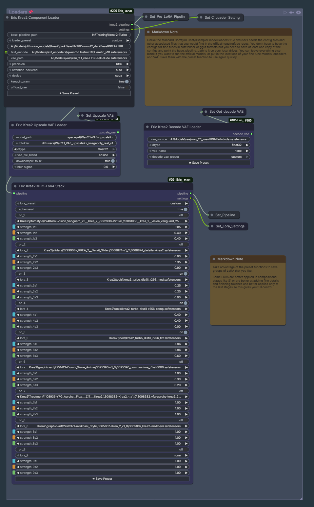
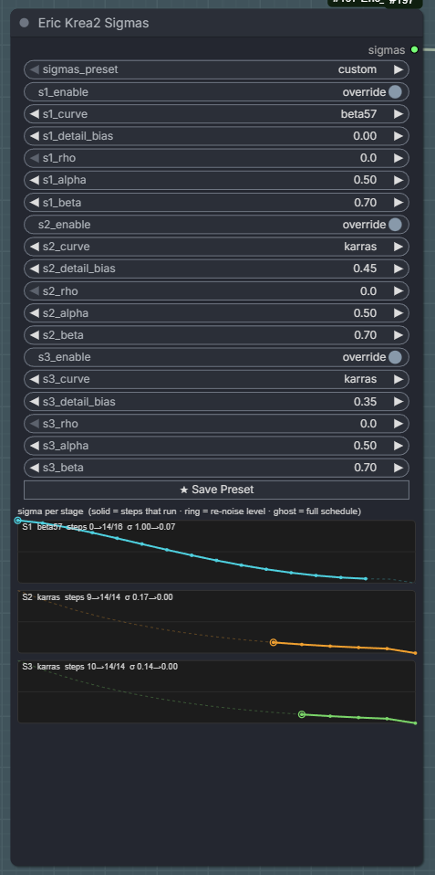
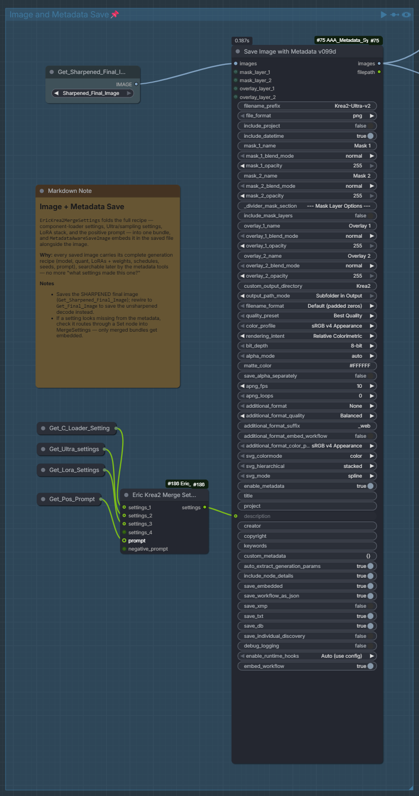
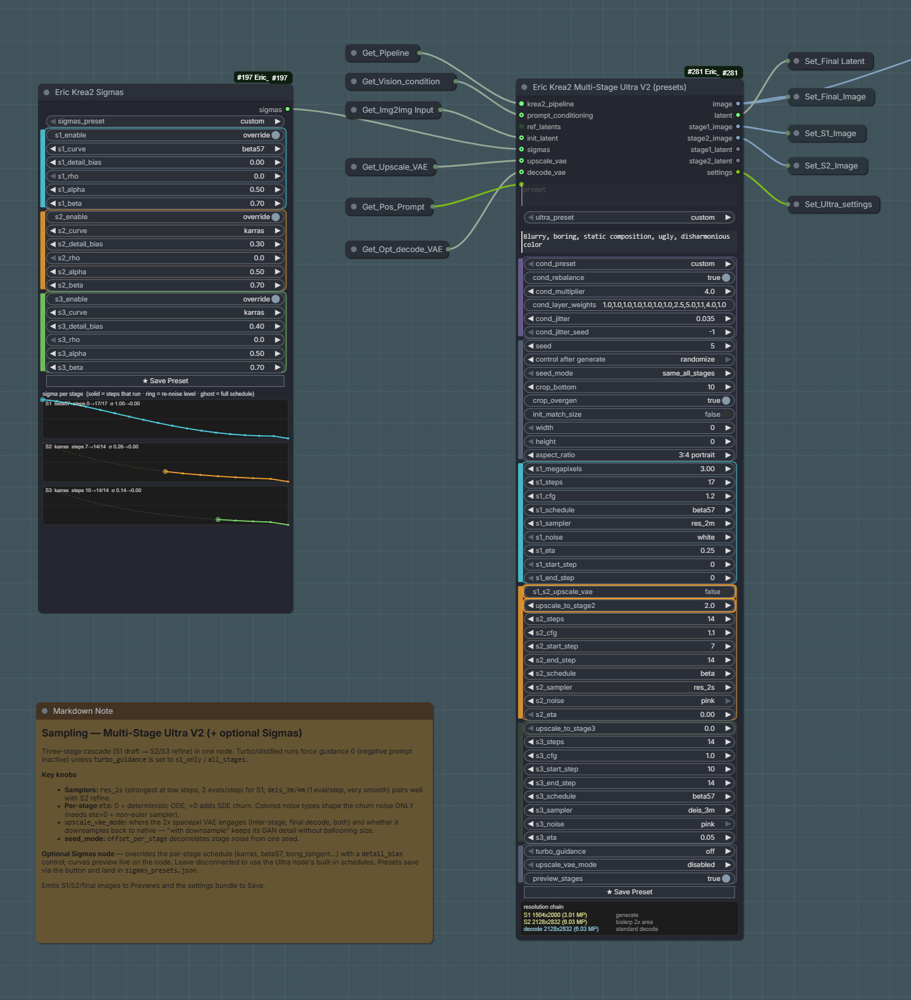
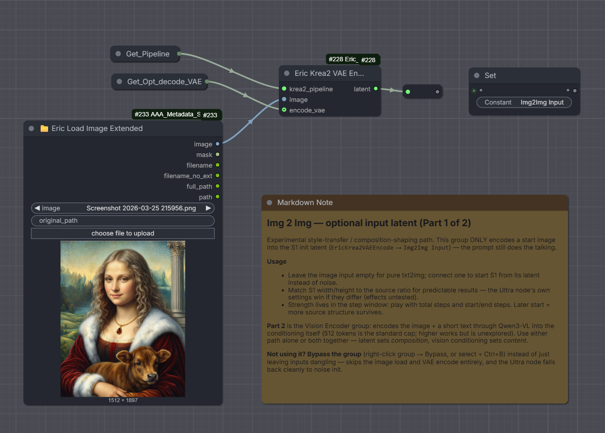
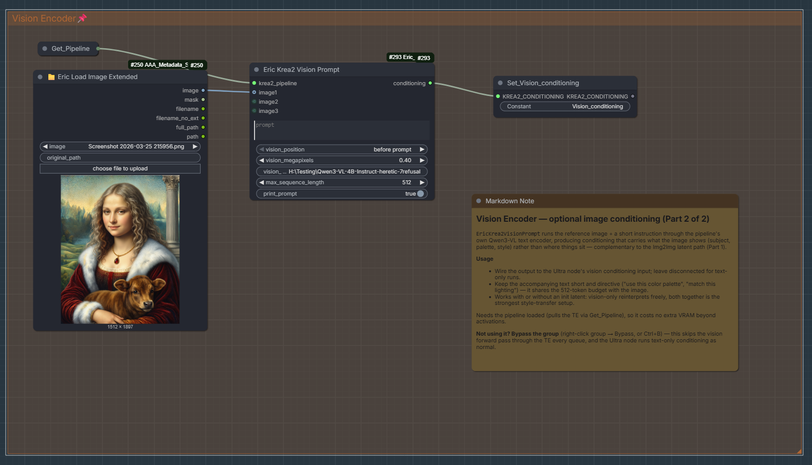

# Eric_Krea2

Self-contained ComfyUI custom nodes for **Krea 2** - Krea AI's open-weight,
from-scratch image model (single-stream MMDiT, flow matching, Qwen3-VL
conditioning). Includes text-to-image, progressive multi-stage high-res
generation, a 2× upscale-decode trick, natural-language prompt tooling, and an
image-to-image suite (control, style, inpaint/outpaint, instruction edits) plus
negative guidance that works on Turbo.

No dependency on any other node pack.

## Why Eric_Krea2 - key advantages

- **Real diffusers pipeline, not a reimplementation.** Runs the genuine Hugging
  Face `Krea2Pipeline` (single-stream MMDiT, flow matching, Qwen3-VL conditioning)
  loaded straight from weights - so you inherit upstream behaviour, fixes and the
  correct trained prompt templates, with no reverse-engineered sampling loop to
  drift out of sync.
- **Easy, honest multi-stage high-res.** Up to 3 progressive stages in one node,
  with per-stage samplers, schedules, guidance and re-noise windows, plus an
  on-node resolution-chain readout so you always see the real S1→S2→S3→decode
  sizes.
- **First-class img2img.** A VAE Encode node feeds an `init_latent` input; denoise
  strength is just the stage's re-noise step window - no separate float to guess.
- **Reference-image style/content grounding (Vision Prompt).** Ground conditioning
  in 1-3 reference images through Krea2's *own* Qwen3-VL vision path - a "prompt
  from a picture" effect (semantic style/content grounding, not pixel editing) with
  no training and none of the silently-discarded-reference pitfalls of the common
  community pattern. Composes freely with img2img for structure + content on
  separate channels.
- **Presets everywhere.** Named JSON presets per section (loader / LoRA / Ultra /
  sigmas) with a ★ Save button, a Merge Settings node, and Settings-from-Image for
  one-click reproduction of a saved image's recipe.
- **LoRA with per-stage settings + presets.** Apply / unload / diagnose plus a
  Multi-LoRA Stack - *both* with per-stage weights (S1/S2/S3), so a LoRA can steer
  composition harder than final detail (or vice-versa) within a single multi-stage
  run, and *both* with named-preset save/load (★ Save) for one-click recall.
- **Reference-latent edit pathway.** With an edit-trained LoRA loaded, a Reference
  Latents node feeds VAE-encoded reference images through the ai-toolkit
  "index_timestep_zero" method - real pixel/structure conditioning (distinct from
  Vision Prompt's semantic grounding), reimplemented against our diffusers transformer.
- **Custom flow-matching samplers, no external solver.** `res_2m`, `res_2s`,
  `deis_3m`, `deis_4m` re-implemented from the RES/DEIS papers, selectable per
  stage, with schedule + `detail_bias` control.
- **Two high-res strategies for two checkpoints.** Turbo → fast 4k via the 2×
  upscale-decode; Raw → controlled multi-stage re-denoise - plus optional
  downsample "quality-pass" VAE modes that are usually cleaner than the Wan 2.1 VAE
  at the same size.

- **A full image-to-image suite on one node.** Control-LoRA ("ControlNet" depth/pose),
  training-free style transfer, inpaint/outpaint with the AnyPaint adapter, and
  instruction/identity editing with the Krea 2 Identity Edit LoRA - each a small builder
  node that plugs into a socket on Multi-Stage Ultra, with per-stage strengths, so the
  same multi-stage high-res engine serves every task.
- **Negative prompts that work on Turbo.** NAG (Normalized Attention Guidance) and NegPiP
  (`(phrase:-1)` in the prompt) give a distilled checkpoint real negatives at guidance 0 -
  no second CFG pass.
- **Native quantized compute.** Run INT8-ConvRot / MXFP8 / NVFP4 / fp8 checkpoints on
  their own tensor-core kernels instead of dequantizing to bf16: ~1.45x faster and ~12 GB
  less VRAM at 3 MP, LoRAs included. Opt-in; bf16 stays the default.
- **Correctness first.** A same-seed A/B found and fixed a diffusers `flash_varlen` bug that
  silently dropped the bottom rows of every Krea 2 image (the "bottom band"); model switches
  no longer leave the previous model resident in VRAM.

## What's New

**Late October 2026 - LoRA picks by creator, one pick per prompt, random word options.**

- **`creator=`** in Sweep Plan catalog picks (`random: catalog creator=Adel_Ai x4`), alias `author=`;
  combines with `tag=`, `kind=`, `role=` and `arch=` (default Krea2, `arch=any` = every base). The
  creator is now part of the searchable card text too, as in the catalog's search box.
- **`per prompt`** - each prompt line gets its own pick, paired instead of crossed: bakeoff
  `random: catalog creator=Adel_Ai per prompt` = one LoRA per prompt; stacks
  `random: catalog creator=Adel_Ai x2 per prompt @0.8` = one 2-LoRA stack per prompt.
- **`#random`** word option in sweeps (`name #random`), **`3: random`** in the LoRA Stack's
  `word_options` (a new option every queue), and an amber dot on stack slots whose LoRA has word
  options but none chosen. See [LoRA picks in the Sweep Plan](#random-lora-picks).

**Late October 2026 - SDE band, rectified-flow churn, trajectory probe.**

- **New node: Eric Krea2 Hybrid Sigma Handoff** (2026-10-23) - wire its `sampling` output into
  Ultra's optional `sampling` input. It holds the hybrid handoff, SDE band and churn form, so the
  Ultra panel stays small; unwired, Ultra behaves exactly as before. **Hybrid handoff by sigma:**
  `sN_hybrid_handoff` switches lcm_hybrid / lcm_hybrid2 from lcm to the tail at a sigma instead of
  a step count (first step at or below it), so one value works on every schedule and step count;
  0.70 reproduces 7 of 12 on linear. 0 = use `sN_hybrid_steps`.
- **SDE band per stage** - `s1/s2/s3_sde_hi` and `_sde_lo` (on the Hybrid Sigma Handoff node) limit eta's
  churn to a sigma range, e.g. noise only in the composition band (1.0-0.5) or only in the detail
  band (0.5-0.15). Defaults (1 / 0) = previous behaviour. The console says how many steps churned.
- **`churn_form` ve | rf** - `rf` injects eta's noise in the rectified-flow form; the classic `ve`
  form over-weights the image signal on flow models (measured +1.4% at eta 0.3, +19.8% at eta 1.0
  on one mid-sigma step). Default `rf` since 2026-10-25, with or without the node (ve burnt all 8 samplers in the screen at eta 0.8); set `ve` on the node to reproduce older eta > 0 images.
- **Trajectory probe** - every stage now prints how fast the model's predicted image changes and a
  free per-step error estimate; sweeps get `probe_*` columns in the CSV and review workbook.
  Diagnostic only, never changes the image.
  See [SDE band, churn form & the trajectory probe](#sde-band-churn-form--the-trajectory-probe).

**Mid-October 2026 - sweeps that explain themselves, random LoRA picks, prompt LoRA tags.**

- **Sweep folders explain themselves** - the Sweep Plan has a new `run_notes` field (last
  widget: why you are running this sweep today). Every sweep folder now gets
  `sweep_info.txt` (preset name, preset notes, run notes, checkpoint, what varied) and
  `sweep_review.xlsx`, a review workbook with thumbnails, what varied, empty columns for your
  own ratings, and the UniPercept scores and metrics. Works for any sweep (LoRA, sampler,
  model...), and is written even when you cancel. See [Parameter sweeps](#parameter-sweeps).
- **Random LoRA picks in the Sweep Plan** - `random: graphic-art x6` in `lora_files` picks 6
  LoRAs from a folder; in stacks mode a slot can be random
  (`random: graphic-art x4 @0.8 | V0id @0.6`). Repeatable by default, `seed=new` for a fresh
  draw. See [Random LoRA picks](#random-lora-picks).
- **Prompt LoRA Tags** - new **Eric Krea2 Prompt LoRA Tags** node: write
  `<lora:Shouji_Ink_KR2:0.66>` in a prompt; the node removes the tag and feeds the LoRA to the
  Multi-LoRA Stack's `suggestions` socket. See [Prompt LoRA tags](#prompt-lora-tags).
- **LoRA names forgive Civitai download names** - a bare name like `Shouji_Ink_KR2` now also
  finds `3317450_shouji_ink_kr2_bf16.safetensors` (version-id prefix and `_bf16` / `_fp16` /
  `_fp8` suffix ignored), as long as exactly one file matches. Used by the Prompt LoRA Tags
  node and the random picks.
- **Sweep names in folders and files** - a sweep folder is now
  `<date_time>_<sweep name>_<checkpoint>` and its files are `sweep_manifest_<name>.json`,
  `sweep_summary_<name>.csv`, `sweep_review_<name>.xlsx`, `sweep_info_<name>.txt`. The name is
  the preset, `custom`, or `<preset>-edited` when you changed a loaded preset - `sweep_info`
  then says which preset and which fields. Older folders keep their old names and still work
  everywhere.
- **Every cell's LoRAs in the CSV and review workbook** - a `LoRAs used` column with each
  cell's actual stack and weights, whatever was swept (rebuilding an older sweep's workbook
  reads it from the cell PNGs).
- **Stack screens: `cross:`, stack_parts, Start 12 / 13** (2026-10-16) - a stack line starting with `cross:` makes
  every combination of its slots' picks (`cross: random: illustration x4 | random: graphic-art x4 | random: treatment
  x4` = 64 stacks). The new Sweep Plan field `stack_parts` (appended last) picks what goes next to each stack:
  each LoRA alone (as before), reference only, build up (A, A+B, A+B+C) or leave one out. Start 12 screens 64
  trios; Start 13 builds up the winners, which the LoRA Catalog's Sweeps page lists for you (Follow-up button).
  See [docs/SWEEPS.md](docs/SWEEPS.md#picking-loras-for-you).
- **Share sheets for posting** (2026-10-16) - a finished sweep also writes ready-to-post JPEGs into
  `<sweep>/share/`: one labelled strip per prompt (prompt and shared settings on top; each image's LoRA short
  name, weight, creator and Civitai model number underneath; 768 px images, wrapping at 6000 px) and/or every
  image labelled on its own. New Sweep Plan fields `share_sheets` / `share_background` (appended last). The new
  **Eric Krea2 Sweep Sheets** node, and the LoRA Catalog's Sweeps page (with your star ratings and notes), make
  them again for any sweep. See [docs/SWEEPS.md](docs/SWEEPS.md#share-sheets-for-civitai-reddit-).
- **Sweep guide, Show plan, Start presets** (2026-10-16) - [docs/SWEEPS.md](docs/SWEEPS.md) is a
  practical guide to the Sweep Plan with examples. *Show plan* (under the node) lists every cell before you
  queue: its LoRAs and weights, its settings and the exact words added to its prompt. Eleven *Start*
  presets cover the common questions (strength ladder, folder bake-off, pairs, samplers, steps, seeds...).
- **Trigger words: four plain choices** (2026-10-16) - on Apply LoRA, Multi-LoRA Stack and Sweep Plan:
  `none`, `trigger` (the card's main trigger), `full` (official words + trigger + style phrase) and
  `saved pick` (the words picked for the loaded checkpoint, else trigger + style phrase; the Sweep Plan's
  new default). Older workflows' off / catalog / recipe load as none / trigger / saved pick.
- **Paste LoRA button on the Multi-LoRA Stack** (2026-10-16) - copy a LoRA in the LoRA Catalog
  (*copy name*, *copy as prompt tag*, or the path) and press *Paste LoRA from clipboard*: it goes into
  the next empty slot at its card weight (a tag's weight wins). Reminder: clicking the middle of a
  slot's dropdown opens a search over names, triggers and catalog cards (Shift+click = plain list).
- **Sweep Plan: Clear button, empty sampler lists** (2026-10-16) - a *Clear sweep* button at the
  bottom of the node puts every field back to its default (keeps `output_folder` and `enabled`,
  empties the notes; asks first). `samplers` and `schedulers` now start empty on a new node; the
  preset *All samplers + schedulers (lists only)* fills both with every option and touches nothing
  else. Nodes already in your workflows keep what they have.
- **`all:` and catalog picks in `lora_files`** (2026-10-16) - `all: illustration` = every LoRA in
  the folder; `random: catalog watercolor x4` and `all: catalog tag="art nouveau"` pick from the
  LoRA Catalog by words and filters. Names typed by hand now resolve like Civitai downloads
  (version prefix and `_bf16` may be left off). See [Random LoRA picks](#random-lora-picks).
- **Prompt words merged for a stack** (2026-10-16) - with `recipe` triggers, the words of all the
  LoRAs in a stack are merged once: repeats dropped, picks kept whole, a word budget shared by
  weight, opposite words ("muted" vs "vibrant") reported. See
  [LoRA trigger words](#lora-trigger-words-base-model-vs-fine-tunes-measured-oct-2026).
- **`<lora:...>` tags in sweep prompts load** - in a sweep, tags in a cell's prompt are taken out
  of the text and loaded for that cell (a tag for a LoRA already in your stack sets its weight).
  Before this they were encoded as plain words and nothing loaded.
- **No more over-cap surprises** - `max_combos` now defaults to 0 = no cap, and the Sweep Plan
  shows the cell count under the node as you edit (counted by the same code the queue runs).
  Nodes already in your workflows keep their saved cap (64): set it to 0 there.
- **`recipe` trigger mode** - on Apply LoRA, Multi-LoRA Stack and the Sweep Plan: each LoRA gets
  the prompt words chosen in the LoRA Catalog for the loaded checkpoint (your pick, else a
  trigger test's pick, else trigger + style phrase). See
  [LoRA trigger words](#lora-trigger-words-base-model-vs-fine-tunes-measured-oct-2026).

**October 2026 - image-to-image suite, negative guidance, native quantized compute.**

- **Control (ControlNet-LoRA)** - new **Eric Krea2 Control** node + Ultra `control` socket:
  depth / pose / canny ... structure control via Krea 2 Control-LoRA checkpoints (expanded
  input layer + block LoRA), per-stage strengths. See [Control](#control-controlnet-lora).
- **Style Reference (training-free)** - new **Eric Krea2 Style Reference** node + Ultra
  `style` socket: transfers palette / brushwork / texture from one image with no LoRA.
  See [Style Reference](#style-reference-training-free).
- **Inpaint / outpaint** - new **Eric Krea2 Paint** + **Paint Composite** nodes + Ultra
  `paint` socket: AnyPaint / Outpaint adapters, kept regions pinned to the source at every
  stage. See [Inpaint / outpaint](#inpaint--outpaint-paint).
- **Edits** - new **Eric Krea2 Edit** node + Ultra `edit` socket: the Krea 2 Identity Edit
  recipe (recolor, restyle, re-pose, add / replace objects, outpaint, person-into-scene),
  with the v1.2 `fit` reference geometry and the `ref_boost` fidelity dial.
  See [Edits](#edits-krea-2-identity-edit).
- **Negative guidance** - new **Eric Krea2 Negative Guidance** node + Ultra `guidance`
  socket: NAG and NegPiP, both off by default, combinable, work at guidance 0.
  See [Negative guidance](#negative-guidance-nag--negpip).
- **Native quantized compute** - Component Loader `compute` / `native_format` (appended):
  run quantized checkpoints on their native kernels. See
  [Native quantized compute](#native-quantized-compute).
- **More checkpoint formats** - the Component Loader now loads MXFP8, NVFP4, ConvRot-W4A4,
  W4A8 and W6A8 single files (ComfyUI `comfy_kitchen` layouts) next to fp8, INT8 and
  INT8-ConvRot. See [Quantized checkpoints](#quantized-checkpoints-the-component-loader-reads).
- **DeGrid** - removes the VAE's 2-pixel lattice: new **Eric Krea2 DeGrid** node, a
  `degrid` toggle on both decode nodes, and `degrid` on Ultra (inter-stage VAE hops and/or
  the final image). See [DeGrid](#degrid-vae-2-pixel-lattice).
- **LoRA search** - click the middle of any LoRA dropdown (Multi-LoRA Stack, Apply LoRA,
  Diagnose LoRA) for a search popup over filenames, folders, trigger words and LoRA
  Catalog cards; Multi-LoRA Stack also gained a `suggestions` socket for the LoRA
  Suggester. See [LoRA search](#lora-search--suggestions).
- **Fixes** - the `flash_varlen` bottom-band bug (all Krea 2 attention is now mask-safe;
  existing seeds render slightly differently, edge to edge correct); VRAM pinned by LoRA
  nodes and by the loader on model switches; the Reference Latents `edit_frame` recipe used
  a stretch instead of the trained fit geometry. See [Notes](#notes).

**Late July 2026 (cont.) - field-calibrated scoring, preset UX, er_sde.**

- **Field-calibrated metrics & captions** - clip% flags at absolute 4%/6%
  thresholds, Tenengrad is the displayed/gated sharpness, splotch and noise
  are demoted to CSV-only, contact-sheet captions use stage-grouped
  shorthand with a compact wrapped metric line, and Auto Pick gained the
  `most_typical` objective (consensus render) plus a uniqueness
  consensus-outlier gate. Calibrated from two full 192-cell runs.
- **Folder scoring chain** - the new `Eric Sweep Folder Scorer` (in
  Eric-image-classification) grades a whole sweep with Blur V7 / Noise V4 /
  composition / exposure / UniPercept and writes a merged `scores.csv` that
  Auto Pick reads via `best_external`: sweep -> unload -> score -> pick ->
  promote in one queue.
- **Sweep presets that show themselves** - the Sweep Plan node joined the ★
  preset system: selecting a preset writes its values into the panel,
  editing flips back to `custom`, and a `preset_notes` field (also on the
  Sigmas node) keeps a saved sentence about what each preset is for.
- **`er_sde` sampler + `simple` scheduler** - a ComfyUI-faithful ER-SDE
  Solver-3 port (verified step-identical): intrinsically stochastic, and
  the only 1-eval/step sampler that is schedule-proof (amplification 0.048
  on EVERY schedule incl. linear_quadratic). eta is ignored; the noise TYPE
  shapes its churn (colored-noise er_sde is unique to this package).
  `simple` = uniform-in-sigma, an alias of `linear`.
- **Swept-schedule precedence** - swept schedule cells now disable a wired
  sigmas bundle for that stage, cell-locally: a swept axis is never
  silently inert.

**Late July 2026 - parameter sweeps, hybrid samplers, inter-stage renorm.**

- **Parameter sweep system** - wire an `Eric Krea2 Sweep Plan` into Ultra V2's
  new `sweep` input and one queue item runs a whole grid (or explicit combo
  list) of sampler / scheduler / steps / window / eta / noise / mu / cfg /
  megapixels settings against a fixed seed: per-cell PNGs with full embedded
  recipes, a labeled contact sheet, `sweep_summary.csv`, a JSON manifest,
  automatic S1-latent reuse for s2/s3-only cells, and one-click promotion of a
  winning cell to a preset. See [Parameter sweeps](#parameter-sweeps).
- **`lcm_hybrid` / `lcm_hybrid2` samplers + `hybrid_split`** - lcm full-churn
  entry (launders upscale damage) handing off to a trajectory-faithful tail
  (`deis_3m` / `res_2m`) at a selectable fraction of the window.
- **`upscale_renorm`** - repairs the latent variance each upscale hop drains
  (variance is contrast/saturation), stopping the progressive flattening of
  multi-hop runs. `per_channel` recommended.
- **Sweep v2: LoRA, prompt & sigma-profile axes** - bake a whole style-LoRA
  library off against the bare checkpoint (or layered on your stack), ladder
  one stack entry through strengths, cross everything with a prompt list and
  with saved sigma-shape presets - all in one queue item, all standalone-
  reproducible per cell.

**July 2026 - multi-stage sampling, presets & img2img toolkit.**

- **Custom flow-matching samplers** - `res_2m`, `res_2s`, `deis_3m`, `deis_4m`
  re-implemented from the RES/DEIS papers (no external solver import), selectable
  per stage. Recommended: `res_2s` + `beta57` for the Stage-1 draft, `deis_3m` /
  `deis_4m` + `bong_tangent` for the refine passes.
- **Shared schedule library + Sigmas node** - `linear`, `balanced`, `karras`,
  `beta57`, `beta`, `bong_tangent`, `exponential`, with a per-stage `detail_bias`
  control driven from a dedicated **Sigmas** node.
- **img2img** - a **VAE Encode** node plus an `init_latent` input on the
  Multi-Stage node; denoise strength is set by the re-noise step window.
- **Vision Prompt** - image-grounded conditioning via Krea2's own Qwen3-VL vision
  path (no training, no VAE/reference-latent pathway needed). Auto-shares its
  megapixel budget across however many reference images are connected. See
  [Vision Prompt](#vision-prompt-image-grounded-conditioning).
- **Resolution & latent helpers** - a **Resolution** node (aspect+MP or
  image-derived size → `width`/`height`/blank latent) and a latent-space
  **Latent Resize** (bislerp, no VAE round-trip).
- **Presets & settings** - named JSON presets per section (loader / component loader /
  Apply LoRA / LoRA stack / Ultra / sigmas) with a ★ Save button, a **Merge Settings**
  node, and **Settings from Image** for one-click reproduction.
- **LoRA tooling** - apply / unload / diagnose plus a **Multi-LoRA Stack**, both with
  **per-stage weights** (S1/S2/S3) and named-preset save/load (★ Save).
- **Reference Latents (edit LoRAs)** - a **Reference Latents** node VAE-encodes 1-3
  reference images into the ai-toolkit "index_timestep_zero" edit pathway, fed via a new
  optional `ref_latents` input on the Multi-Stage Ultra (res) node. Works *only* with an
  edit-trained LoRA loaded (e.g. the Krea 2 Style Reference LoRA on Turbo at guidance 0);
  the base model can't read reference tokens. See
  [Reference Latents](#reference-latents-edit-lora-image-conditioning).
- **Upscale VAE quality-pass modes** - the trained spacepxl Wan 2× decoder can drive
  the S2→S3 jump and/or the final decode, each with a **downsample** variant that keeps
  its sharp detail but resamples down to your chosen size instead of forcing 4× area.
  The `… with downsample` modes are usually **cleaner/sharper than the Wan 2.1 VAE** at
  the same output size and avoid the resolution blow-up. An on-node **resolution-chain
  readout** shows the real S1→S2→S3→decode sizes and flags any field the VAE overrides.
  See [Upscale VAE: modes & precedence](#upscale-vae-modes--precedence).

*Initial release (June 2026):* Krea 2 Raw + Turbo support, multi-stage high-res,
2× upscale-decode, selectable attention backend, natural-language prompt builder +
LLM Magic-Prompt expander.

## Requirements

These nodes drive the **genuine Hugging Face `Krea2Pipeline`** directly (see
[key advantages](#why-eric_krea2---key-advantages)); the only hard requirement is a
diffusers/transformers build new enough to expose it.

- A **diffusers** build that includes `Krea2Pipeline` (merged after `0.39.0.dev0`):

  ```
  python_embeded\python.exe -m pip install --upgrade --force-reinstall --no-deps git+https://github.com/huggingface/diffusers.git
  ```

  The version string stays `0.39.0.dev0`, so `--force-reinstall` is required to
  pull the newer commit.
- A `transformers` new enough to provide `Qwen3VLModel`.
- Krea 2 weights in diffusers layout (e.g. `H:\Training\Krea-2-Raw` and
  `H:\Training\Krea-2-Turbo`).
- *Optional, recommended on Blackwell:* FlashAttention and/or SageAttention for
  the faster `attention_backend` paths. Kernel bench on an RTX PRO 5000 (sm120, Krea 2 shapes,
  2026-10-08): flash-attn 2 = baseline; SageAttention 2 `sageattn` (int8 QK, fp8 PV) 1.6-1.8x
  faster per attention call with ~4% relative error (cos 0.9992); its Triton varlen kernel
  (what `attention_backend=sage` picks first) only 1.13-1.17x; xformers and cuDNN SDPA = flash.
  The dense kernel is the **`sage_fp8`** choice (last in the list). End to end on Turbo, 8 steps:
  **-4-6% step time at 1.5 MP, -9-12% at 3 MP, -19% at 8.4 MP** (10.2 -> 8.3 s/step). Images are
  equally clean (text, skin, frost detail checked at 1:1) but not seed-identical to flash - the
  small per-call error steers the trajectory, so the same seed gives a sibling image, sometimes a
  different framing. Edit / NAG / ref_boost runs still use flash for their split attention.
- *Optional:* the spacepxl Wan 2× upscale VAE (auto-downloaded on first use).
- *Optional:* `flash-attn` (2.8+) - also used by the edit / NAG / ref_boost attention core
  (falls back to an exact but slower math path without it).
- *Optional:* ComfyUI's `comfy_kitchen` (ships with recent ComfyUI) - needed for MXFP8 / NVFP4 /
  W4A4 / W4A8 / W6A8 checkpoints and for `compute = native`.
- *Optional, per feature:* Control-LoRA, AnyPaint and Identity Edit LoRA weights (see each section).

## Example workflow


A single, multi-purpose graph lives in [workflows/](workflows/). **Drag
`example-workflow.png` onto the ComfyUI canvas** (the graph is embedded in the
PNG metadata) to load the whole pipeline at once - loaders, txt2img, img2img,
Vision Prompt, per-stage sampling, and the metadata-aware save. Flip parts on/off
with group **bypass** (Ctrl+B) instead of juggling separate workflows. See
[workflows/README.md](workflows/README.md) for the group-by-group breakdown.

## Nodes

### Core generation

| Node | Does |
|------|------|
| **Eric Krea2 Loader** | Loads `Krea2Pipeline` (Raw or Turbo), applies `attention_backend`, caches in VRAM. Auto-detects `is_distilled`. Preset dropdown. |
| **Eric Krea2 Generate** | Text-to-image. Emits `IMAGE` + a chainable `KREA2_LATENT`. `auto_settings` picks 8/0 for Turbo, 28/4.5 for Raw. |
| **Eric Krea2 Multi-Stage Ultra (res)** | Up to 3-stage progressive high-res with the custom RES/DEIS samplers, per-stage schedules, img2img `init_latent`, an optional `ref_latents` edit input, and `width`/`height` overrides. Sockets for [control, style, paint, edit and negative guidance](#image-to-image-control-style-paint--edit); `degrid` for the VAE lattice. Best on Raw for multi-stage re-denoise. |
| **Eric Krea2 Multi-Stage Ultra V2 (presets)** | Preset-driven variant of the Ultra node - serialises every widget (incl. `sigmas`, `width`/`height`) into one reproducible recipe. |



*The loader group - the Component Loader (with `loader_preset`), the Upscale and Decode VAE loaders, and the growable Multi-LoRA Stack with per-stage strengths. Each carries its own ★ Save Preset button.*

### Sampling & scheduling

| Node | Does |
|------|------|
| **Eric Krea2 Sigmas** | Per-stage schedule overrides (S1/S2/S3): curve, `detail_bias`, Beta α/β. Emits a `KREA2_SIGMAS` bundle the Ultra nodes fold in. |



*The Sigmas node: per-stage curve / `detail_bias` / Beta α-β overrides with a live sigma preview per stage (solid = steps that run, ring = re-noise level, ghost = full schedule).*

Samplers (per stage, on the Ultra node): `euler`, `res_2m`, `res_2s`, `deis_3m`,
`abnorsett_3m`, `abnorsett_4m`, `lawson4_4s`, `etdrk4_4s`, `er_sde`,
`rk6_7s`, `lcm`, `lcm_hybrid`, `lcm_hybrid2`.
Schedules: `linear`, `balanced`, `karras`, `beta57`, `beta`,
`bong_tangent`, `exponential`, `linear_quadratic`, `simple`
(= ComfyUI's uniform-in-sigma scheduler; alias of `linear` here).
See [Samplers & schedules](#samplers--schedules).

### Sweeping & characterization

- **Eric Krea2 Sweep Plan** - builds a `KREA2_SWEEP` plan (grid axes or
  JSON-lines combos, stage scoping, quick-screen mode, output folder, hard
  combo cap, LoRA bake-offs / stacks with random picks, `run_notes`). Wire into
  Ultra V2's `sweep` input.
- **Eric Krea2 Sweep → Preset** - promotes any cell of a finished sweep's
  manifest into `ultra_presets.json`, tagged with the checkpoint name.
See [Parameter sweeps](#parameter-sweeps).

### img2img, resolution & latents

| Node | Does |
|------|------|
| **Eric Krea2 VAE Encode** | Encodes an `IMAGE` → `KREA2_LATENT` (the img2img primitive). |
| **Eric Krea2 Reference Latents (Edit)** | VAE-encodes 1-3 reference images → `KREA2_REF_LATENTS` for the Ultra (res) node's `ref_latents` input (ai-toolkit "index_timestep_zero" edit method). **Needs an edit-trained LoRA** - without one the base model does not ignore the reference tokens, they corrupt the image into a blocky mosaic. See [Reference Latents](#reference-latents-edit-lora-image-conditioning). |
| **Eric Krea2 Resolution** | Size from `aspect_ratio` + `megapixels` or a source image → `width`/`height`/`dims` + a blank `KREA2_LATENT` (noise or zeros). |
| **Eric Krea2 Latent Resize** | Resize a `KREA2_LATENT` in latent space (bislerp, no VAE round-trip): `scale` / `dimensions` / `megapixels`. |
| **Eric Krea2 Latent → ComfyUI LATENT** | Bridge a `KREA2_LATENT` to a stock ComfyUI `LATENT`. |

### Image-to-image: control, style, paint & edit

Each builds a bundle for one socket on **Multi-Stage Ultra** (all sockets were appended -
saved workflows are untouched). Nothing loads or runs in these nodes; Ultra installs the
runtime for one generation and removes it afterwards (cancel-safe).

| Node | Ultra socket | Does |
|------|--------------|------|
| **Eric Krea2 Control (Depth/Pose ControlNet-LoRA)** | `control` | Control image + Control-LoRA checkpoint + per-stage strengths (S1 1.0 / S2 0.5 / S3 0). See [Control](#control-controlnet-lora). |
| **Eric Krea2 Style Reference (training-free)** | `style` | Style image + `recommended` / `custom` preset + per-stage multipliers (S1 only by default). See [Style Reference](#style-reference-training-free). |
| **Eric Krea2 Paint (inpaint / outpaint)** | `paint` | Source + mask and/or outpaint padding, adapter (`anypaint` / `outpaint` / `none`), per-stage restore + adapter switches. Outputs the bundle, a `vlm_image` for Vision Prompt, a canvas preview and the generated mask. See [Inpaint / outpaint](#inpaint--outpaint-paint). |
| **Eric Krea2 Paint Composite** | - | Optional pixel-exact paste-back of the source outside the mask with a feathered edge. |
| **Eric Krea2 Edit** | `edit` | Source image (+ optional second reference), edit instruction, `fit_mode`, `ref_boost` / `ref_boost_a` (+ mask), `grounding_px`, `size_from`, `ground_negative`. See [Edits](#edits-krea-2-identity-edit). |
| **Eric Krea2 Negative Guidance** | `guidance` | NAG (own negative text, phi / tau / alpha, stages, sigma window) and NegPiP (mode, strength, block range, text-fusion option). See [Negative guidance](#negative-guidance-nag--negpip). |

**Which sockets combine (one run):**

| | control | style | paint | edit | guidance | ref_latents |
|---|---|---|---|---|---|---|
| **control** | - | yes | yes | yes | yes | yes* |
| **style** | yes | - | no | no | skipped | no |
| **paint** | yes | no | - | no | skipped | no |
| **edit** | yes | no | no | - | yes | no |
| **guidance** | yes | skipped | skipped | yes | - | skipped |
| **ref_latents** | yes* | no | no | no | skipped | - |

"no" raises a clear error (both wrap the transformer forward); "skipped" runs the other one
and prints that guidance was ignored.

Control with edit or ref_latents: the control hint is applied to the target image tokens only;
reference tokens bypass the Control-LoRA (before 2026-10-08 control was silently dropped
whenever reference tokens were present). \*control + ref_latents is verified to apply control
on every step; a full visual run with the edit LoRA at 1.5 MP spilled VRAM on a 48 GB card
shared with displays, so try 1 MP first.

### Decode

| Node | Does |
|------|------|
| **Eric Krea2 Upscale VAE Loader** | Loads the spacepxl Wan 2× upscale decoder → `UPSCALE_VAE`. Optional `downsample_to_1x` + `blur_sigma`: decode at 2× then Lanczos-downsample back to native size - a supersampling-style quality pass instead of a literal resolution gain. Travels with the loaded VAE into every consumer (see [Upscale VAE: modes & precedence](#upscale-vae-modes--precedence)). |
| **Eric Krea2 Decode VAE Loader** | Loads a plain decode VAE. |
| **Eric Krea2 Upscale Decode (2×)** | Decodes a `KREA2_LATENT` via the upscale VAE (no re-denoise). Resolution and any downsample/blur are whatever the loaded `UPSCALE_VAE` was configured with. |
| **Eric Krea2 VAE Decode** | Plain 1× decode of a `KREA2_LATENT`. |
| **Eric Krea2 DeGrid (VAE grid remover)** | Removes the VAE's 2-pixel lattice from any image (auto-calibrated notch, untouched when clean) + removed-grid preview and report. Both decode nodes also gained a `degrid` toggle. See [DeGrid](#degrid-vae-2-pixel-lattice). |

### Presets, LoRA & utilities

| Node | Does |
|------|------|
| **Eric Krea2 Merge Settings** | Merges section recipe strings into one `KREA2_SETTINGS` (dicts updated, `lora` lists concatenated). |
| **Eric Krea2 Settings from Image** | Reads an image's embedded generation settings back into a `KREA2_SETTINGS` recipe. |
| **Eric Krea2 Component Loader** | Loads pipeline components (base folder + optional single-file transformer / VAE / text encoder) with a preset dropdown. Reads bf16, GGUF, fp8, INT8, INT8-ConvRot, MXFP8, NVFP4, ConvRot-W4A4, W4A8, W6A8 ([formats](#quantized-checkpoints-the-component-loader-reads)); `compute` = `bf16` or `native` quantized kernels ([native compute](#native-quantized-compute)); VAE tiling controls. |
| **Eric Krea2 Apply LoRA** / **Unload LoRA** / **Diagnose LoRA** | Apply, cleanly remove, and inspect LoRA adapters on the cached pipeline. Apply LoRA supports **per-stage weights** (`per_stage_weights` + `weight_s1`/`weight_s2`/`weight_s3`) so a LoRA's strength can differ across S1/S2/S3 in a multi-stage run, plus a **preset dropdown** (`apply_lora_preset` + ★ Save). |
| **Eric Krea2 Multi-LoRA Stack** | Stack several LoRAs in one growable node - each slot has **per-stage weights** (`strength_Ns1`/`s2`/`s3` for S1/S2/S3) and an on/off toggle, plus a shared `ephemeral` switch and a **preset dropdown** (`lora_preset` + ★ Save). Unused rows auto-hide until needed. Click the middle of a LoRA dropdown for the 🔍 [search popup](#lora-search--suggestions) (also on Apply / Diagnose LoRA); optional `suggestions` socket for the LoRA Suggester. |
| **Eric Krea2 Prompt LoRA Tags** | Reads `<lora:name:weight>` tags out of a prompt, outputs the prompt without them plus a LoRA list for the Multi-LoRA Stack's `suggestions` socket (with trigger words). See [Prompt LoRA tags](#prompt-lora-tags). |
| **Eric Krea2 Unload Models** | Free VRAM on demand. |
| **Eric Krea2 Save Latent (debug)** | Save/inspect a packed latent for debugging. |



*Reproducibility: Merge Settings folds the loader + Ultra + LoRA + prompt recipes into one bundle that gets embedded in the saved PNG - readable back later via Settings from Image.*

### Prompting

| Node | Does |
|------|------|
| **Eric Krea2 Prompt** | Assembles structured fields into a dense, comma-joined natural-language prompt; quotes text-to-render. |
| **Eric Krea2 Magic Prompt** | Expands a short prompt via a local LLM (LM Studio / Ollama / any OpenAI-compatible endpoint). |
| **Eric Krea2 Vision Prompt** | Grounds conditioning in 1-3 reference images via Krea2's own Qwen3-VL vision path, using Krea2's *trained* descriptor template (not the generic Qwen-Image-Edit template). Emits `KREA2_CONDITIONING` → Ultra's `prompt_conditioning` input. See [Vision Prompt](#vision-prompt-image-grounded-conditioning) below. |

## Samplers & schedules

Each stage of the Multi-Stage Ultra node picks a **sampler** (the ODE solver) and a
**schedule** (the sigma spacing) independently.



*A full sampling group - the Sigmas node feeding Multi-Stage Ultra V2, with per-stage samplers/schedules, guidance, re-noise windows, and the on-node resolution-chain readout.*

**Samplers**

| Sampler | Order | Model calls / step | Best for |
|---------|-------|--------------------|----------|
| `euler` | 1 | 1 | Baseline / native parity (the comfy euler+simple twin). Honours early stop and eta (runs as a 1-stage RK). |
| `res_2m` | 2 (multistep) | 1 | General use - sharper than Euler at the same cost. |
| `res_2s` | 2 (single-step) | 2 | Low step counts / Stage-1 draft. Self-starting; ~2× slower. |
| `deis_3m` | 3 (multistep) | 1 | Smooth refine passes. |
| `deis_4m` | 4 (multistep) | 1 | Smoothest refine at higher step counts. |
| `rk6_7s` | ~6 (7-stage RK) | 7 | Maximum solver accuracy (finetuner recipes; the Raw model). ~7x cost per step - overkill for Turbo daily use. |
| `abnorsett_4m` | 4 (exp. multistep) | 1 | Recipe-name alias of `deis_4m` - identical update in this solver formulation. |
| `lcm` | ancestral | 1 | Post-upscale refine windows: jumps to x0 and fully re-noises every step, laundering upscale artifacts. Not for Stage 1. |

Every sampler honours a *noisy early-stop* (`end_step < steps`), letting a stage
hand a partially-denoised latent to the next, and supports the ancestral `eta`
SDE path (`lcm` is inherently fully ancestral - see below). Since the 2026-07-22
shift-consistency fix, `euler` runs through the same solver path as every other
sampler (as a 1-stage Runge-Kutta), so the re-noise level and the stepping always
share one sigma space. The math is recreated from the RES (arXiv:2308.02157) and
DEIS (arXiv:2204.13902) papers plus standard Butcher tableaus - no external
solver code is imported.

**Schedules:** `linear`, `balanced`, `karras`, `beta57`, `beta`, `bong_tangent`,
`linear_quadratic` (ComfyUI-core slow-linear-then-quadratic descent; the kreamania pass-1 schedule),
`exponential`. The **Sigmas** node adds a `detail_bias` knob (biases sigma spacing
toward fine detail vs. large structure) and Beta α/β shaping.

**Recommended pairings** (per the RES4LYF community):
- **Stage 1 (draft):** `res_2s` + `beta57`.
- **Stage 2/3 (refine):** `deis_3m` or `deis_4m` + `bong_tangent`.
- **Post-upscale laundering (native-parity chains):** `lcm` + `linear` with a deep window - see below.

Native parity note: `linear` + `distilled_shift=fixed` reproduces ComfyUI's
`euler`/`simple` spacing exactly (same uniform grid, same exponential mu=1.15
shift) - that pairing IS the native baseline, not an approximation of it.

### Choosing a sampler per stage: warmup & accuracy

Two independent properties decide which solver fits a stage. They often point in
opposite directions, so it's worth understanding both rather than just copying the
pairings above.

**1. Multistep warmup (order build-up).** Multistep solvers (`res_2m`, `deis_3m`,
`deis_4m`) reach their rated order by fitting a polynomial through *past* steps, so
they start low-order and ramp up:

| Step in the run | `deis_3m` effective order |
|-----------------|---------------------------|
| 1st | 1 (Euler-like) |
| 2nd | 2 |
| 3rd onward | 3 (full) |

Crucially, **each stage restarts the solver** - the history buffer is empty at the
stage boundary and does *not* carry across the re-noise handoff. So the ramp is
measured from the first step of *that stage's* run, not the global step index. A
Stage-3 run of `steps=14, start=7, end=14` is **7 sampling steps**, of which the
first ~2 are below full order (full 3rd order from its 3rd step ≈ global step 9).
`deis_4m` ramps over ~3 steps and needs even more runway. Sub-order steps aren't
"wrong" - they're just Euler/2nd-order accurate - but at low step counts the warmup
eats most of the run and the higher order never pays off.

`res_2s` is **self-starting** (a self-contained predictor+corrector, 2 model calls
per step) - full order from step 1, no warmup - which is why it wins when steps are
scarce. Cost balances out because you use fewer of them: `res_2s` @ 4 steps = 8
calls ≈ `deis_3m` @ 7 steps = 7 calls, but cleaner at the low count.

**2. Trajectory smoothness (from-noise vs from-clean).** This is why Stage 1 uses a
single-step solver even though it has plenty of steps to amortize warmup:

- **Stage 1 starts from pure noise** (σ≈max). The early high-σ steps are where the
  model's x₀ prediction is roughest and swings hardest step-to-step, *and* where
  global composition is decided. Multistep solvers extrapolate a polynomial through
  those past predictions, so rough/rapidly-changing history risks **overshoot/ringing
  exactly where structure is set**. `res_2s` doesn't rely on history, so it's robust
  on that rough start, and its corrector buys accuracy on the most consequential
  steps of the whole pipeline.
- **Stages 2/3 start from an already-clean latent** (low-mid σ, smooth trajectory).
  Here the multistep history is reliable, so `deis_3m`'s cheap high-order
  extrapolation genuinely shines.

**Putting it together:**

| Stage | Trajectory | Steps | Pick | Why |
|-------|-----------|-------|------|-----|
| S1 draft | from noise | long | `res_2s` | robustness on the rough start > cheap order |
| S1 draft (cost-saving) | from noise | long | `res_2m` | multistep middle ground: 1 call/step, some early robustness given up |
| S2/S3 refine | from clean | long (≥~8-10) | `deis_3m` | smooth trajectory + cheap order; warmup amortized |
| S2/S3 refine | from clean | very long, smooth schedule | `deis_4m` | marginal extra accuracy once there's runway |
| S3 light refine / no upscale | from clean | few | `res_2s` | self-starting - no warmup waste when steps are scarce |

Rules of thumb: **from noise → self-starting (`res_2s`)**; **from clean + many steps
→ multistep (`deis_3m`/`4m`)**; **from clean + few steps → back to `res_2s`** (no
warmup to waste). `deis_4m` only over `deis_3m` on long, smooth, high-step runs; it's
more prone to overshoot on short or noisy-early-stop stages.

### Trajectory vs churn: where `lcm` fits

Every sampler answers the same question - "given where the latent is and how noisy
it should be, where does it go next?" - and they split into two philosophies.

**The ODE family** (`euler`, `res_2m`, `res_2s`, `deis_*`, `rk6_7s`) treats
denoising as following a *trajectory*. Each step nudges the current latent along
the flow, so information accumulates: real structure, but also upscale ridges,
interpolation error, and leftover mottling get carried forward, refined, and
sharpened into the output. The members differ only in how accurately they follow
the path (euler crudely, rk6_7s obsessively). Faithful is their virtue and their
flaw: they preserve everything, including what you wish they would not.

**`lcm` is the other philosophy.** Each step asks the model for its best guess of
the finished image (the x0 prediction), then throws the current latent away and
rebuilds the next one as that guess plus fresh noise at the next sigma (the
flow-matching mix `(1 - sigma) * x0 + sigma * noise`). No trajectory, no memory:
whatever damage the latent carried - contour lines from a latent upscale, seam
echo, mismatch residue - is discarded every step and replaced by the model's own
clean prior plus new noise. That is why it launders artifacts that deterministic
ODE samplers faithfully integrate. The price is symmetric: it also discards fine
detail the trajectory was carrying, drifts more from the init, and shows larger
seed-to-seed variety.

**The choice rule:** damaged starting latent you want repaired -> `lcm`. Precious
starting latent you want preserved -> an ODE sampler. In between - trajectory with
some laundering - is exactly what `eta > 0` on the res/deis samplers is.

Concretely: post-upscale refine windows are lcm home turf (the latent just got
stretched and is full of interpolation artifacts - the entire secret of the
native euler -> lcm two-pass chains). Stage 1 is ODE territory: you are building
structure from noise and want it followed faithfully, and Turbo is TDM-distilled,
not LCM-distilled, so full-ancestral from pure noise reads rough and unstable.
A same-resolution polish on an already-good image is a judgment call: shallow lcm
freshens texture and kills residue; shallow deis/res preserves likeness.

**What shapes lcm's churn** (it consumes fresh noise every step, so it is the
sampler most sensitive to what that noise is):

- **Window depth** (`start_step`/`end_step`): how much of the image gets rebuilt.
  Deeper start = more repair, more drift.
- **Step count**: number of churn events across the same sigma range - more steps
  = finer-grained laundering.
- **Schedule curve + `detail_bias`** (Sigmas node): where the re-noise ladder
  concentrates. Positive bias packs churn events at low sigma (texture polish);
  negative packs them high (structural repair).
- **`distilled_shift` / mu**: moves the whole ladder (higher mu = more time spent
  churning at high sigma = smoother, deeper repaint).
- **`noise_type` and `eta`**: lcm-family re-noise draws are ALWAYS plain seeded
  white - the model was trained on white noise at every sigma, and a FULL
  replacement with colored noise is out-of-distribution (it decodes as
  chromatic blotches over the image). `noise_type` shaping applies only to the
  fractional SDE churn of the res/deis/rk samplers at `eta > 0`. For
  colored-noise grain character, use `deis_3m`/`res_2m` with eta 0.5-1.0 and a
  `noise_type` - not lcm.
- **Per-stage seed** (`seed_mode`): lcm windows show more seed variety than the
  deterministic solvers - that is the churn, not a defect.

**Recommended lcm refine baseline** (the native-parity chain):

- **S2:** 12 steps, window 6 -> 12 (6 denoise steps), `lcm` + `linear`,
  `distilled_shift=fixed`, eta 0, white noise; `upscale_to_stage2` ~1.2 (area),
  S1->S2 VAE upscale OFF (plain latent hop).
- **S3:** 12 steps, window 5 -> 12, otherwise identical; `upscale_to_stage3` ~1.5.
- Artifacts surviving the window -> start deeper (5 or 4). Likeness drifting ->
  start shallower (7-8). Want extra texture -> `detail_bias` +0.2..+0.3.
- Keep lcm off Stage 1 (see above).

### The lcm hybrids & `hybrid_split`

Pure `lcm`'s weakness is that its final detail is bounded by the x0 prediction
at the entry (highest-sigma) steps: the first full re-noise discards the
incoming trajectory - including the previous stage's real detail - and later
steps only polish that re-invention. The hybrids keep lcm's artifact
laundering where it works (the entry steps, where upscale damage lives) and
then develop detail trajectory-faithfully at low sigma, where detail is
actually made:

- **`lcm_hybrid`** - lcm churn, then a `deis_3m` tail.
- **`lcm_hybrid2`** - lcm churn, then a `res_2m` tail (added 2026-07-25;
  res_2m has been testing better than deis_3m as the detail-development half
  on several fine tunes - both tails cost the same per step).
- **`s1/s2/s3_hybrid_steps`** (Ultra widgets, default 0) - the handoff in
  EXACT lcm steps at the head of that stage's window. 0 = auto (half the
  window, ceil - the original behavior). At low step counts this is the
  honest control: a fraction only has window-1 real values, so small %
  changes were silent no-ops. Fewer lcm steps = more trajectory-faithful
  detail; more = more laundering. Clamped so both halves always run; ignored
  by every other sampler. Sweepable via the `hybrid_steps` axis or combos
  JSON (`{"s2_hybrid_steps": 4}`).
- `eta`/`noise_type` apply to the tail half only; the lcm half is inherently
  fully ancestral and always re-noises with plain seeded white (colored
  noise as a full replacement is out-of-distribution -> rainbow blotches).
- `eta` contract: honoured by `res_2m`/`res_2s`/`deis_3m`/`abnorsett_3m`/
  `abnorsett_4m`/`lawson4_4s`/`etdrk4_4s`/`rk6_7s` and the hybrid tails;
  **ignored by `euler` and `lcm`** (euler is the deterministic baseline -
  enforced in the dispatch, and the Sweep Plan automatically drops cells
  that differ only by inert eta/noise on those samplers).

**The Norsett & exponential-RK additions (2026-07-27):** `abnorsett_4m` is
no longer a deis alias - it is the genuine fixed-coefficient Norsett
exponential Adams-Bashforth method (RES4LYF-faithful, verified against its
phi tables), with `abnorsett_3m` as its 3rd-order sibling; the weights
depend only on the current step size, so they stay BOUNDED on every
schedule. `deis_4m` was removed: its exact variable-step weights blow up on
strongly non-uniform ladders (measured 269x on `linear_quadratic`) and
amplify model-prediction noise into garbage - if a saved workflow used it,
pick `abnorsett_4m` (stable order 4, same 1 call/step) or `deis_3m`.
`lawson4_4s` and `etdrk4_4s` are single-step exponential RK order 4
(4 model calls/step, no history): the most noise-robust solvers in the
package, stable everywhere, strong candidates for refine windows. Note
lawson is deliberately not phi-exact for constant forcing (classical
Lawson quadrature) - a texture character difference from etdrk4, not a bug.

### Sampler x schedule pairing guide (12 steps, measured 2026-07-28)

Numbers = median deviation of the final state when the model's per-step
predictions disagree by 2% (the solver's amplification of prediction noise;
lower = more stable). Stability is necessary, not sufficient - which stable
pair looks BEST for a given fine tune is what the sweep decides.

| sampler | best schedules | fine | avoid |
|---|---|---|---|
| `euler`, `res_2s` | any (0.017-0.029) | - | - |
| `lawson4_4s`, `etdrk4_4s` | any (0.009-0.022, noise-suppressing) | - | - |
| `res_2m` | exponential/beta/beta57/karras (0.020-0.022) | linear (0.053) | linear_quadratic (0.152) |
| `deis_3m` | exponential/beta57/beta/karras (0.022-0.025), `OPT-DEIS12` ★ (karras +0.75 bias, 0.023) | bong_tangent/balanced (~0.03), linear (0.118) | linear_quadratic (0.834) |
| `abnorsett_3m` | beta57/beta (0.021), exponential/karras (0.022-0.025) | linear (0.060), linear_quadratic (0.115) | - |
| `abnorsett_4m` | beta57/beta (0.022), `OPT-AB412` ★ (beta57 +0.5 bias) | exponential/karras (~0.03), linear_quadratic (0.178) | - |
| `er_sde` | ANY - 0.048 flat on every schedule incl. linear_quadratic (stochastic contraction; schedule-proof at 1 eval/step). Community recipe: + `simple` @ 8 steps | - | - |
| `lcm_hybrid`/`2` | beta57/beta/karras/exponential (0.023-0.028) + the EXP ★ family | bong_tangent (~0.026) | linear (0.055-0.116), linear_quadratic (~0.15) |

Detail-bias windows (how far you can push `detail_bias` before conditioning
degrades, per curve): deis_3m stays clean on exponential to +0.25, on
beta57/beta from -0.75 to +0.5, and on karras it IMPROVES with positive bias
(clean -0.25 to +0.75 - positive bias straightens the karras tail in
t = -log sigma, which is why `OPT-DEIS12` = karras +0.75 is both the most
detail-holding and among the most stable deis_3m curves). abnorsett_4m:
beta57/beta clean -0.75..+0.5; exponential to 0; karras never fully clean.
Single-step order-4 samplers ignore conditioning entirely - schedule choice
is pure aesthetics there. `OPT-DEIS12` and `OPT-AB412` ship as ★ sigma
presets (S1-only, 12-step recipes).

**Field-tested Stage-1 recipe (2026-07-26, found with the sweep system):**
12 total S1 steps with either hybrid (`lcm_hybrid` / `lcm_hybrid2`) over an
exponential-family custom sigma curve (authored in the Eric Krea2 Sigmas
node and saved as ★ presets - e.g. the EXP1-EXP4 set) lands among the
fastest runs while holding up across most fine tunes and curves. The
handoff sweet spot is **`s1_hybrid_steps = 7` of 12** for most model/curve
combinations. Treat it as a development control: **5-6** lcm steps hands
off earlier and develops more fine detail; **8** (sometimes 9) launders
longer for a cleaner, less-detailed look. The recipe re-derives itself per
fine tune in one sweep: samplers `lcm_hybrid, lcm_hybrid2` x
`hybrid_steps` `5, 6, 7, 8` x your saved curves in `sigma_profiles`.


### SDE band, churn form & the trajectory probe

Added 2026-10-22 (spec: `docs/spec_sde_band_and_trajectory_probe_2026-10-22.md`).

**SDE band.** eta adds fresh noise after each step ("churn"). By default that happens on every
step of the window. `sN_sde_hi` / `sN_sde_lo` restrict it to the steps whose *next* sigma lies
inside the band; the rest of the window runs deterministic. It works with res_2m, res_2s,
deis_3m, abnorsett_3m/4m, lawson4_4s, etdrk4_4s, rk6_7s and the tail of the lcm hybrids (euler,
lcm and er_sde ignore it). Rough Krea2 guide: sigma 1.0-0.5 shapes composition and large
structure, 0.5-0.15 form and detail, below that micro texture. ComfyUI's SA-Solver uses the
band 0.93-0.44 on Krea2 (its 20-80% window at shift 1.15). Every churning stage prints e.g.

    S1 SDE churn (ve, eta 0.5): band sigma[0.93->0.44]: 7/12 steps churned, sigma_next 0.90...0.51

because how many steps land in a band depends on the schedule, steps, shift and window.

**churn_form.** `ve` is the classic k-diffusion ancestral step (and ComfyUI's res_multistep
ancestral). On a flow model it leaves too much image signal in the latent for the sigma the model
is told - measured on a 0.760 -> 0.693 step: +1.4% at eta 0.3, +19.8% at eta 1.0. `rf` is the
rectified-flow form ComfyUI uses for euler_ancestral_RF: it rescales the latent so the signal
matches the sigma exactly. The same eta number means different amounts of noise in the two
forms, so compare them in a sweep (`churn_forms: ve, rf` crossed with `etas`), not at one eta.
Default `rf` since 2026-10-25 (an 8-sampler screen: ve burnt every sampler at eta 0.8, rf held). Images made with eta > 0 before that date used `ve`: set churn_form ve on the Hybrid Sigma Handoff node to reproduce one.

**Trajectory probe.** A measurement, never a change to the image. At each step it reads the
model's predicted clean image and prints per stage:

    [EricKrea2-Probe] S1: lte sum 0.041 peak 0.012 @sigma0.71 | late(<0.3) 18% | drift peak 0.84 @sigma0.84 | clean 9/10 steps

- *drift* - how fast the predicted image is changing per step of log-sigma. Its peak is where the
  model is making its biggest decisions.
- *lte* - a free local-error estimate (difference between a 2nd-order predictor and corrector
  through the same predictions). High where the trajectory bends faster than the steps follow:
  the place to add steps when designing a curve. Proportional to the real error, so compare
  shapes and rankings, not absolute values.
- *late* - share of the error below sigma 0.3 (fine detail).
- *clean* - steps not disturbed by churn noise. Only clean steps count, so read the probe at
  eta 0 or outside the SDE band; lcm steps and er_sde never count.

In sweeps the same numbers land in `sweep_summary.csv` and `sweep_review.xlsx` as `probe_*`
columns next to your ratings, and the full per-step curves go into `sweep_manifest.json`
(`trajectory`). Stage 1 euler text-to-image runs through the stock pipe and is not probed.

**Hybrid handoff by sigma** (2026-10-23, Hybrid Sigma Handoff node). `sN_hybrid_steps` sets the
lcm -> tail switch as a step count, which lands at a different sigma on every schedule and step
count. `sN_hybrid_handoff` sets it as a sigma: the lcm head runs until the ladder reaches it and the
tail takes over from the first step at or below it. The console prints the split, e.g.
`S1 hybrid handoff: 7/12 lcm steps -> tail from sigma 0.69 (handoff sigma 0.70 requested)`.
**Choosing a handoff - detail vs clean.** The handoff is a dial, not a fixed best value. Higher
(earlier switch, longer res_2m tail) = more fine detail and texture, with more risk to composition
and correct drawing; lower (more lcm steps) = cleaner, more correct structure, softer detail. On 12
linear steps: ~0.78 detailed, 0.65 balanced (the node default), 0.45-0.55 clean. Field results
(2026-10-23, Eric's ratings): the darkroom prompt preferred 0.70, the coastal-house prompt 0.60,
some subjects 0.45 - architecture, glass and hands tend to want lower, textured or atmospheric
scenes can take higher. Values only matter where they land on the ladder: on 12 linear steps the
real switch points are sigma 0.76 / 0.69 / 0.61 / 0.51 / 0.39, so 0.5 and 0.4 give the same image.
eta, churn_form and the SDE band changed little on the hybrid (the tail is short and low-sigma);
rf only helps with a long tail (high handoff) at eta > 0.

**Strategy - clean structure first, detail later** (untested idea). Use a low S1 handoff (~0.5) to
get correct composition and drawing, then let S2 put detail back on that settled structure (an S2
refine window starting around sigma 0.5-0.6 with a detail-leaning sampler, or a modest S2 eta).
Detail added during refinement sits on a structure that is already right, so it is less likely to
draw things wrong than detail grown in S1. Test: S1 handoff 0.5 vs 0.78, each with and without the
S2 detail pass - if clean S1 + S2 beats detailed S1, use it for subjects that need both.

Refine windows (S2/S3) start at sigma 0.5-0.76, so keep their handoff inside the window. The node's
churn_form defaults to `rf` - in the first res_2m sweep it never clipped while `ve` burnt at eta 0.7-1.0.

**Sweep axes.** `hybrid_handoffs` takes sigmas (`0.8, 0.7, 0.6, 0.5`). `sde_bands` takes `hi-lo` pairs (`1-0, 0.93-0.44, 1-0.5, 0.5-0.15`) for the
scoped stages; `churn_forms` takes `ve, rf`. Cells where the band can't matter (euler, lcm,
er_sde, or eta 0 in the cell) are removed as duplicates.


## img2img



*img2img (Part 1): a start image is VAE-encoded into the S1 `init_latent`. Denoise strength lives in the step window; the prompt still does the talking. Bypass the group for pure txt2img.*

```
Load Image → Eric Krea2 VAE Encode → (init_latent) Multi-Stage Ultra
                     └→ Eric Krea2 Resolution (image) → width/height → Multi-Stage Ultra
```

Stage 1 re-noises the `init_latent` at `s1_start_step` and denoises the
`[s1_start_step, s1_end_step]` window - so **denoise strength is the step window**,
not a separate float. Feed `width`/`height` from the Resolution node (or turn on
`init_match_size`) to size Stage 1 to the source image.

## Vision Prompt (image-grounded conditioning)



*Vision Prompt (Part 2): a reference image + a short instruction run through Krea2's own Qwen3-VL vision path → `KREA2_CONDITIONING`. Sets content/style; pairs with img2img for structure.*

```
Load Image(s) -> Eric Krea2 Vision Prompt -> (prompt_conditioning) Multi-Stage Ultra
```

Pushes 1-3 reference images through Krea2's own text encoder's vision path (it's a
Qwen3-VL VLM, not text-only), so the resulting conditioning is visually grounded by
those images - a "prompt from a picture" effect - without training anything and
without the pitfalls of the community pattern of reusing the core
`TextEncodeQwenImageEditPlus` node for this: that node's VAE-encoded reference goes
nowhere (the *base* Krea2 DiT has no reference-latent pathway - `Krea2.extra_conds`
never reads reference_latents, so it's silently discarded; an edit-trained LoRA is what
adds one, exposed separately via the
[Reference Latents](#reference-latents-edit-lora-image-conditioning) node), and it falls
back to Qwen3-VL's generic image-description template once an image is attached instead of the
descriptor template Krea2 was actually conditioned with. This node has no VAE step at
all (nothing to discard) and always uses Krea2's own `prompt_template_encode_prefix`/
`_suffix`, read straight off the loaded pipeline so it can't drift out of sync.

**This is semantic grounding, not pixel editing.** With no reference-latent pathway of
its own it gives no structure/identity preservation from the image alone - for that,
pair it with img2img (below): img2img supplies structure (what to start denoising from),
Vision Prompt supplies content (what to draw toward). They're independent channels
into the transformer and compose freely, including with different source images
for each. (If you have an edit-trained LoRA, the
[Reference Latents](#reference-latents-edit-lora-image-conditioning) node adds a third,
pixel-level channel.)

**Positive-conditioning only.** Steering *toward* a reference makes sense; steering
*away* from one is a much stranger ask, and Turbo (the primary target) mostly runs
`cfg=0` anyway - no negative pass to feed. When `prompt_conditioning` is connected,
Ultra's own `prompt` field is entirely inert (not used, not logged) - put your text in
the Vision Prompt node's own `prompt` field instead. `cond_rebalance` still applies to
it, identically to a text-only encode.

**Token budget - the one thing to know before your first run.** Krea2 was trained
with a *fixed* 512-token text budget (prefix + images + prompt, always padded/
truncated to exactly this length) - unlike Qwen-Image's dynamic per-batch padding,
which is why Qwen-Image tolerates a much higher `max_sequence_length` more gracefully.
One full-resolution (1 MP) reference image alone is ~988 tokens - nearly double the
whole budget before your prompt or even the 34-token prefix. To keep this workable
out of the box, the node auto-shares a ~0.40 MP budget across however many images you
connect (1 image ≈ 0.40 MP, 2 ≈ 0.20 MP each, 3 ≈ 0.13 MP each) and raises a clear,
specific error - with a suggested `vision_megapixels` value - rather than silently
truncating into the image-token block (which corrupts position ids and crashes deep
inside `get_rope_index` with a cryptic shape-mismatch instead). `vision_megapixels` is
a ceiling on top of the auto-share, not a replacement for it - lower it to reserve more
room for a long prompt.

## Reference Latents (edit-LoRA image conditioning)

```
Load Image(s) -> Eric Krea2 Reference Latents -> (ref_latents) Multi-Stage Ultra (res)
```

A second, *pixel-level* way to condition on a reference image - complementary to
[Vision Prompt](#vision-prompt-image-grounded-conditioning)'s semantic grounding. Each
reference image is VAE-encoded and flow-packed exactly like a generation latent, then its
tokens are appended to the image sequence and modulated at **t = 0** (clean data) - the
ai-toolkit "index_timestep_zero" edit method. The velocity prediction is sliced back to
the live image tokens, so the references only *inform* the denoise, they aren't denoised
themselves.

**Requires an edit-trained LoRA.** The base Krea2 model was never trained to read these
tokens - this pathway only does something useful with an ai-toolkit `krea2` edit LoRA
(`model_kwargs.edit: true`) loaded, e.g. the Civitai **Krea 2 Style Reference LoRA**.
Without one, the reference tokens are **not** ignored: the base model reads them as image
content and the output breaks up into a blocky mosaic (tested 2026-10-08, with and without
control). Cost is ~2048 extra tokens per 1 MP ref, per denoise step.

**Recommended wiring** (matches the Style Reference LoRA's training setup):
- the reference image(s) → **Reference Latents** (`max_ref_megapixels` 1.0) → `ref_latents`;
- the *same* image(s) → **Vision Prompt** (`vision_megapixels` ≈ 0.15) → `prompt_conditioning`;
- the edit LoRA in the **Multi-LoRA Stack** at strength 1.0;
- **Turbo** checkpoint at **guidance 0**.

**CFG caveat.** The transformer-forward wrapper can't tell a positive pass from a negative
one, so with guidance enabled the references condition *both* passes and partially cancel
in the CFG delta. Keep it on Turbo at `g = 0` (which is what the published edit LoRAs
target anyway). This is an independent diffusers-side reimplementation of the published
mechanism (mechanism credit: ostris / ai-toolkit), not a port.

**Two recipes (`edit_recipe` on the Reference Latents node).** `ostris_t0` (above) is for
style / reference LoRAs. `edit_frame` is the identity / instruction edit method - sources
prepended on the target grid at frame 1..N, shared timestep - placed with the krea2edit v1.2
`fit` geometry (Oct 2026; it previously stretched mismatched aspect ratios) and active on the
stage whose grid it was encoded for. For the Krea 2 Identity Edit LoRA use the dedicated
[Edit node](#edits-krea-2-identity-edit) instead - it adds the grounded instruction encode,
ref_boost and the trained negative.

## Control (ControlNet-LoRA)

```
Load Image -> (depth / pose / canny preprocessor) -> Eric Krea2 Control -> (control) Multi-Stage Ultra
```

Krea 2 "ControlNet" checkpoints are Control-LoRAs: the DiT input projection is expanded
from 64 to 128 channels (`[noisy patches ; control patches]`, trained weights in the
checkpoint) plus a rank-64 LoRA on every block. The control image is VAE-encoded and enters
**clean at every step**. Everything is forward hooks for one generation - nothing is merged
into the weights, so it composes with the LoRA stack and never leaks.

- **Checkpoint** - public: `Patil/Krea-2-depth-controlnet` (trained on Raw, works on Raw
  and Turbo, ~1 MP buckets). Put it in your Krea2 LoRA folder; files with `control` in the
  path are listed first. The checkpoint decides the control *type* - a depth LoRA needs a
  depth map.
- **Depth maps** - `channel_mode` grayscale, `normalize` per_image_minmax, near = **white**
  (`invert` if your preprocessor gives near = dark). Pose / canny / lineart: `rgb`, `none`.
- **Per-stage strength** - scales the block LoRA (the reference's `--lora-scale`); the
  expanded input layer is always full. `0` = that stage runs the stock model. Defaults
  S1 1.0 / S2 0.5 / S3 0 - structure is set in S1, S3 runs far above the trained size.
- The control image is cover-cropped and re-encoded at **each controlled stage's own
  resolution** - keep it at the generation's aspect ratio.

## Style Reference (training-free)

```
Load Image (style) -> Eric Krea2 Style Reference -> (style) Multi-Stage Ultra
```

Transfers a reference's palette, brushwork, texture and rendering language without a LoRA
(port of nkxx188/ComfyUI-Krea2-StyleTransfer). Every styled step runs the model on
`[target, reference]`: the reference is noised to the target's level along a model-guided
trajectory, and in blocks 7-27 the target attends to the reference's keys/values with
frequency-band reweighting - early it may align to the reference layout, late it can no
longer copy positions (no content leakage) but still pulls style statistics.

- **`preset`** - `recommended` locks the original author's low-leakage tuning (custom
  widgets ignored); `custom` exposes them (`ref_k_strength`, `low_scale_end`,
  `high_scale_start/end`, `adain_strength`, `ref_value_mix`, `value_adain_strength`,
  `beta`, `blocks`, `trajectory`, `gamma`).
- **`style_strength`** - overall amount; ~1.0 is strong and coherent at 3 MP; 2.0 can
  overshoot. **`s1/s2/s3_strength`** multiply it per stage; S2/S3 default 0 (S2 refines S1's
  styled result at full speed).
- **`trajectory`** - `model_pc` (original, ~2 x `trajectory_steps` extra evaluations per
  styled stage) or `linear` (free, weaker).
- **Cost** - ~2.3-2.6x per styled step plus the trajectory pass; a 3 MP S1 run on a 48 GB
  card takes ~2 min. On cards under 64 GB with guidance off, the prompt is encoded once and
  the text encoder parks on the CPU for the run so the doubled batch fits.

## Inpaint / outpaint (Paint)

```
Load Image (+ mask) -> Eric Krea2 Paint -> (paint) Multi-Stage Ultra -> [Paint Composite]
                         \-> vlm_image -> Eric Krea2 Vision Prompt (image1, picture_n) -> prompt_conditioning
```

Implements the yijunwang2 **AnyPaint** / **Outpaint** functional adapters on our model:

- a small **condition image** (the canvas with every to-be-generated pixel filled with the
  median known colour, <= 384 px) is registered onto the target grid by fractional RoPE
  coordinates, its keys/values computed once at t = 0 (isolated kv_cache);
- **kept regions are pinned to the source** in velocity space - every sampler (euler, RES,
  DEIS, hybrids, CFG) lands exactly on the source there;
- Stage 1 Euler runs on our fp32 solver when paint is active (bit-level parity with the
  author's pipeline; the stock pipe's bf16 loop drifted).

Settings:

- **`adapter`** - `anypaint` (arbitrary masks, inpaint + outpaint, one pass; put
  `krea2_anypaint_rank32` on the LoRA stack, S1 = 1, S2/S3 = 0), `outpaint` (older,
  rectangular only), `none` (training-free: only pins the kept region - fine for small
  inpaints). Krea 2 **Turbo**, 8 steps, guidance 0.
- **mask** - 1 = generate (ComfyUI mask-editor convention). **`pad_left/right/top/bottom`**
  add outpaint canvas. **`seam_px`** (32) is regenerated around the mask so it blends.
- **`restore_s1/s2/s3`** - `on` pins kept regions every step, `structure` pins while sigma >
  `structure_release_sigma` (0.4) then frees the low-noise detail steps, `auto` = `on` when
  the source has the stage's resolution else `structure`, `off` lets the stage rewrite.
  Defaults on / auto / auto keep identity through S2/S3 without forcing upsampled blur.
- **`adapter_s1/s2/s3`** - adapter conditioning per stage (default S1 only; trained at
  <= 1024 px targets).
- Stage 1 follows the **canvas aspect** at `s1_megapixels` unless width/height are set;
  `crop_bottom` is disabled for paint runs.
- **Paint Composite** pastes the source back with a feathered edge for pixel-exact
  preservation (the Outpaint adapter's post step; AnyPaint does not need it).

## Edits (Krea 2 Identity Edit)

```
Load Image -> Eric Krea2 Edit (instruction) -> (edit) Multi-Stage Ultra
Multi-LoRA Stack: krea2_identity_edit_v1_2  S1 = 1.0, S2 = 0, S3 = 0
```

Instruction editing - recolor, restyle, re-pose, add / replace / remove objects, outpaint,
try-on, person-into-scene - with the **Krea 2 Identity Edit** LoRA
(`conradlocke/krea2-identity-edit`, v1.2; full or the near-identical r128 / r64 files).
Two conditioning paths, exactly as the LoRA was trained:

- **appearance** - the clean VAE-encoded source sits in the sequence as
  `[text | source (frame 1) | source_b (frame 2) | target (frame 0)]`, shared timestep;
- **semantics** - the instruction is encoded by Qwen3-VL **together with the source
  image(s)** ("grounded", natural length - no 512 cap, two 768 px references exceed it).

Settings:

- **`fit_mode`** - `fit` (v1.2 training geometry: AR-preserving resample onto the target
  grid at a fractional centered offset, any output aspect; byte-identical to krea2edit
  v1.2.5) or `crop (legacy)` for v1 / v1.1 weights.
- **`ref_boost`** - reference-fidelity dial: multiplies target -> reference attention
  (1 = off; ~4 strong likeness; >10 breaks removals; <1 loosens). Applies to the last
  reference (the subject in two-reference edits); **`ref_boost_a`** is the scene's dial;
  **`ref_boost_mask`** limits the boost to a region of the last reference (e.g. a face).
  In tests ref_boost 4 kept the source's silhouette closer (a long coat stayed long when
  recoloured).
- **`grounding_px`** - longest side the VLM sees (trained 384-768, default 768): lower =
  stronger instruction adherence, higher = stronger likeness; lower it if subjects duplicate.
- **`size_from`** - `source`: Stage 1 takes the source aspect at `s1_megapixels` (Ultra
  width/height still win); `ultra settings`: Ultra decides and `fit` handles the mismatch
  (wide outpaints).
- **`ground_negative`** - with CFG on, the negative is the empty instruction grounded on
  the same image - the trained unconditional.
- **`source_image_b`** - second reference (the subject) for person-into-scene; place two
  people in ONE pass rather than chaining edits.

Recipe notes (model card + our tests):

- **Turbo, 8-12 steps, guidance off** for most edits; Stage 1 **<= 2 MP** (warned above
  2.2 MP - sources bleed / subjects duplicate). Let S2/S3 upscale.
- **Stages 2/3** run stock (no sources) and refine with **Ultra's `prompt` text** - describe
  the edited image there; empty prompt = they reuse the grounded instruction.
- **Removals** are the weak spot. The card's recipe is **Raw, ~20 steps, CFG 3**
  (`s1_cfg` 2.0 - Krea's g, CFG = 1 + g) with `ground_negative` on; in our test even that
  removed *both* people for "remove the person in the background". Word removals by what to
  keep.
- Prefer ODE samplers (euler, RES, DEIS) for outpainting - SDE churn breaks the reference
  copy channel.
- Cost: the source doubles the image tokens (~3.1 s/step at 1.5 MP on an RTX PRO 5000 vs
  1.3 s for plain text-to-image); ref_boost adds ~6%.
- `crop_bottom` is disabled for edit runs; with `prompt_conditioning` also connected, the
  edit's grounded conditioning wins (printed).

## Negative guidance (NAG & NegPiP)

```
Eric Krea2 Negative Guidance -> (guidance) Multi-Stage Ultra
```

Both are **off by default**, both work at **guidance 0** (Turbo), and they can be combined
with each other and with an edit. Ultra's `negative_prompt` stays the CFG negative.

**NAG - Normalized Attention Guidance.** A negative text stream (`nag_negative`) runs
through the blocks next to the positive one. For the image queries the attention output is
pushed away from the negative and renormalised:
`z = z+ + phi (z+ - z-)`, L1 ratio clamped to `tau`, blended `alpha` into the positive.
Text and edit-source tokens keep their positive attention.

- `nag_phi` 4.0, `nag_tau` 2.5, `nag_alpha` 0.25 (the published defaults),
  `nag_stages` s1 / s1_s2 / all, `nag_sigma_start/end` limit it to a sigma window.
- In tests it suppressed an unwanted feature (wings on a llama-bird) cleanly with a small
  remnant. Cost: ~+23% per step on text-to-image, ~+12% on edits (single pass - CFG would
  be +100%).

**NegPiP.** Write `(phrase:-1.0)` in Ultra's prompt or the Edit instruction: that phrase's
attention **values** are multiplied by its weight inside the joint blocks, so a negative
weight subtracts the concept instead of adding it.

- `negpip_mode` - `in_place` (default; the phrase stays where it is, its tokens are flagged -
  cleanest in tests) or `lifted` (the phrase is removed and encoded on its own, appended).
- `negpip_strength` multiplies every negative weight; `negpip_block_start/end` limit the
  blocks; `negpip_text_fusion` also flips inside the text-fusion attention (stronger).
- Positive weights are stripped (Krea 2 conditioning has no prompt weighting). With a
  precomputed `prompt_conditioning` (Vision Prompt) the text can't be parsed - put the
  groups in Ultra's prompt instead. Cost ~0.

**Using both** on the same concept over-suppressed in tests (dark patches) - pick one per
concept.

All three features (edit sources + ref_boost, NAG, NegPiP) share one exact attention core:
keys are attended group by group and merged by log-sum-exp, so ref_boost needs no dense
L x L bias (which would force slow SDPA and run out of memory at 3 MP) and NAG's positive
and negative passes share the expensive image attention. Verified against dense reference
implementations (docs/tools/test_edit_guidance_math.py).

## Native quantized compute

**Component Loader → `compute`** (`bf16` default | `native`) and **`native_format`**
(`keep` | `int8` | `mxfp8` | `nvfp4`), both appended.

`bf16` dequantizes every checkpoint to bf16 (best image quality). `native` re-quantizes the
28 joint blocks' 224 Linear layers after loading and runs them on ComfyUI's `comfy_kitchen`
tensor-core kernels - the same path ComfyUI core uses; everything else stays bf16.

- `keep` uses the checkpoint's own format (INT8 → int8-ConvRot when the file is rotated,
  MXFP8, NVFP4, fp8); a bf16 / GGUF source falls back to mxfp8. Explicit `int8` / `mxfp8` /
  `nvfp4` quantize any source on load. NVFP4 uses a dynamic per-call activation scale.
- Requires `precision` bf16 and a CUDA device.
- **LoRAs work:** PEFT LoRAs run their delta in bf16 on top of the quantized layer (effect
  identical to bf16 in tests); direct-merge LoRAs (LoKr / LoHa / diff) become exact bf16
  side terms instead of being written into the quantized weights.
- **Image quality:** activations are quantized too, so results differ slightly from bf16 -
  at the same seed, typically 26-30 dB PSNR (looks the same side by side); fp8 can shift
  composition a little. Your call per workflow.

Measured, RTX PRO 5000, Ultra S1-only 3 MP, 8 steps:

| checkpoint (`keep` →) | bf16 s/step / VRAM | native s/step / VRAM |
|---|---|---|
| INT8-ConvRot (int8_convrot) | 2.9 / 34.8 GB | **2.0 / 22.9 GB** |
| same + a style LoRA | 3.1 / 35.3 GB | **2.2 / 22.9 GB** |
| MXFP8 (mxfp8) | 2.9 / 35.0 GB | **2.1 / 23.3 GB** |
| fp8-scaled (fp8) | 2.9 / 35.1 GB | **2.0 / 22.9 GB** |

Headless bench (same card): nvfp4 1.75 s/step (1.67x). The gain shrinks at 8 MP, where
attention (untouched by quantization) dominates the step.

## Quantized checkpoints the Component Loader reads

Single-file transformers are dequantized on load (on the GPU): **fp8** (bare / scaled),
**INT8** and **INT8-ConvRot** (group-wise Hadamard un-rotation), and - through
`comfy_kitchen`'s own layouts, mirroring `comfy/ops.py` - **MXFP8**, **NVFP4**,
**ConvRot-W4A4**, **W4A8** and **W6A8**. GGUF loads as before (dequantize on load).
`docs/tools/krea2_checkpoint_inspector.py` reports any file's format and whether it loads,
without loading it. Note: a file's *name* is not proof of its format - one "INT8-ConvRot"
download in testing was actually bf16 (the loader logs what it found).

## DeGrid (VAE 2-pixel lattice)

The Qwen-Image VAE leaves a faint fixed-phase 2-pixel grid in decoded images (strongest in
flat / dark areas), and the spacepxl 2x upscale VAE builds its output with a 2x2
`pixel_shuffle`. When an inter-stage VAE hop decodes, upsamples and re-encodes, that lattice
is fed into the next stage, which can develop it into a weave-like texture. DeGrid is an
exact 2-pixel notch filter (filter core from lunaaispace-eng/ComfyUI-DeGrid), amplitude-
limited so real edges pass, and an image with no detected lattice is left untouched.

- **Eric Krea2 DeGrid** - standalone node for any image: `mode` auto / manual (`limit`),
  `skip_when_clean`, and a `removed_grid` preview (x `grid_gain`) + report. Put it straight
  after a decode, before sharpening / resizing.
- **`degrid`** toggle on **Upscale Decode (2x)** and **VAE Decode** (appended).
- **Ultra `degrid`** (appended): `hops` cleans the inter-stage VAE upscale before re-encoding
  (no effect on plain latent hops - they have no pixel step), `final` cleans the decoded
  output, `hops+final` both. The console prints the measured grid amplitude per pass.

## LoRA search & suggestions

- **🔍 Search popup** - click the **middle** of a LoRA dropdown on the Multi-LoRA Stack,
  Apply LoRA or Diagnose LoRA node: a search box over filenames, folders, trigger words and
  **LoRA Catalog** cards (name, role, effect text, artists, depicts, facet tags). The arrow
  zones still step prev / next, Shift+click opens the native list, and right-click the node
  → "Search LoRA ..." per slot is a fallback. No widgets are added - saved workflows are
  untouched. Catalog location: env `ERIC_LORA_CATALOG`, else video_prompter's config,
  else `L:/Models/loras/_lora_catalog.sqlite`; a missing catalog just means fewer fields.
- **`suggestions` socket** on the Multi-LoRA Stack - LoRAs picked by the LoRA Suggester
  (video_prompter) are added after the panel's own slots with their per-stage weights and
  trigger words; a file already in the stack is not added twice. The Prompt LoRA Tags node
  feeds the same socket.

### Prompt LoRA tags

The **Eric Krea2 Prompt LoRA Tags** node lets you load LoRAs from the prompt text, the way
A1111-style prompts do:

```
a woman in a red coat <lora:Shouji_Ink_KR2:0.66>, rain
```

| Tag | Weight |
|---|---|
| `<lora:name>` | 1.0 on all stages |
| `<lora:name:0.66>` | 0.66 on all three stages |
| `<lora:name:1/0.7/0.4>` | per stage S1 / S2 / S3 |
| `<lora:name:0.8:0.5>` (A1111 model:text-encoder) | the first number |

**Wiring:** prompt in -> the node's `prompt` output (tags removed, stray commas tidied) goes
on to the Multi-LoRA Stack's `prompt` input or the text encoder; its `loras` output goes into
the Multi-LoRA Stack's `suggestions` socket. The stack adds those LoRAs after its own slots,
never twice, with their trigger words (the LoRA Catalog card trigger first) in the
`add_triggers` merge. The `summary` output lists what was loaded.

**Names** are found like everywhere else in the pack: a full path, a loras-folder path
(extension optional), or the bare file name / stem in any subfolder. Civitai download names
are forgiven: `Shouji_Ink_KR2` finds `3317450_shouji_ink_kr2_bf16.safetensors` (the leading
version id and a `_bf16` / `_fp16` / `_fp8` suffix are ignored), but only when exactly one file
matches. An unknown or ambiguous name stops the run with the reason and the candidates;
`on_missing = skip` drops it with a console note instead.

## LoRA trigger words: base model vs fine-tunes (measured Oct 2026)

How much a LoRA needs its trigger words depends on the **checkpoint**. A trigger test (LoRA Catalog
`run.py triggers --plan-test`, details in the catalog's `docs/TRIGGERS.md`) rendered five Krea 2 style
LoRAs with each prompt variant - no words, the trigger token, the official trained words, trigger + style
phrase - plus a words-only cell without the LoRA, on three checkpoints. Score = CSD style gain toward the
LoRA's own look over that checkpoint's plain no-LoRA render (one seed, one neutral subject, card weights):

| LoRA | variant | Lox (fine-tune) | FinalCut (fine-tune) | base turbo |
|---|---|---|---|---|
| Michael Parkes | no words / trigger / official | +0.00 / +0.01 / +0.55 | +0.03 / +0.02 / +0.52 | **+0.44** / +0.24 / +0.57 |
| Liquid Chalk | no words / trigger / trigger+phrase | +0.03 / +0.02 / +0.43 | +0.06 / +0.46 / +0.42 | **+0.60** / +0.60 / +0.69 |
| Ukiyo-e | no words / trigger / official | -0.02 / +0.06 / +0.39 | -0.03 / +0.04 / +0.36 | +0.03 / +0.38 / +0.49 |
| Ballpoint | no words / trigger | +0.02 / +0.80 | +0.17 / +0.82 | +0.08 / +0.70 |
| zy cinematic | no words / trigger / trigger+phrase | +0.00 / +0.01 / +0.18 | +0.04 / +0.20 / +0.33 | +0.08 / +0.14 / +0.35 |

- **Base turbo:** two of the five (Parkes, Liquid Chalk) show strongly with no words at all, and the bare
  trigger token works far better than on the fine-tunes (Ukiyo-e +0.38 vs +0.06 on Lox). Stacks can stay
  lean - a trigger, not a paragraph - leaving more of the 507-token budget for the subject and more LoRAs.
- **Fine-tunes:** most LoRAs do almost nothing on a neutral prompt, and the bare trigger token does not
  change that. The official trained words or trigger + a style phrase switch them on. Budget their words.
- **Sometimes the words alone do it:** on Lox, Ukiyo-e and zy cinematic scored nearly the same from the
  words without the LoRA - the checkpoint already knows that look.
- **One trigger, two behaviours:** Ballpoint and Liquid Chalk share `n0vuschr0ma style`; on Lox it switches
  Ballpoint fully on and does nothing for Liquid Chalk.

Practical consequence for the trigger modes (`add_triggers` on the LoRA / Multi-LoRA Stack nodes,
`lora_triggers` on Sweep Plan): `catalog` sends one short trigger, which is enough on the base model and
often not enough on a fine-tune; `prepend` sends every Civitai trigger word. When testing a LoRA on a
fine-tune, test it with its words.

**The `recipe` trigger mode (2026-10-15)** puts these findings to work. On Apply LoRA, the
Multi-LoRA Stack (`add_triggers`) and the Sweep Plan (`lora_triggers`), `recipe` prepends each
LoRA's *prompt words* from the LoRA Catalog, chosen for the checkpoint that is loaded (the
transformer file's name, the same name a sweep folder carries):

1. your pick for this checkpoint (card editor "Prompt words", or "use words" on the Sweeps page),
2. a trigger test's pick for this checkpoint (`run.py triggers --check`),
3. your pick for every checkpoint, else the newest test pick,
4. the recipe's trigger + style phrase (untested),
5. the card's first trigger; no catalog words at all: as `catalog`.

A pick of the *no words* variant adds nothing on purpose (some LoRAs show best without words on a
base checkpoint). The console line says where each LoRA's words came from.

**Merging a stack's words (2026-10-16, `_prompt_merge.py`).** With two or more LoRAs in
`recipe` mode (Multi-LoRA Stack, Sweep Plan stacks), the words are merged once for the whole
stack instead of pasted end to end:

1. *Repeats* - a phrase said twice is kept once; a phrase whose words all sit in a longer
   phrase of another LoRA is dropped ("watercolor washes" inside "delicate layered watercolor
   washes"); phrases the prompt already says are dropped.
2. *Picks* - a LoRA whose words are a pick (yours or a trigger test's) keeps all of them.
3. *Order and length* - each LoRA's first phrase (its trigger) comes first, in stack order,
   then phrases two LoRAs share, then the rest. The other LoRAs share a budget of about 60
   words by weight; each keeps its first two phrases at least.
4. *Conflicts* - opposite words between LoRAs, or a LoRA and the prompt ("muted" vs
   "vibrant", "photorealistic" vs "anime", "dark" vs "airy" ...), are printed in the console
   and, in a sweep, recorded per cell (`word_conflicts`). Nothing is removed for a conflict;
   that choice is yours.

A single LoRA's words are used as they are.

## Two high-res strategies

Krea 2's two checkpoints suit two different paths:

**Turbo → fast 4k (no re-denoise).** Turbo is distilled (8 steps, guidance 0) and
resists partial re-denoise, but the 2× decode sidesteps that entirely:

```
Loader (Krea-2-Turbo) → Generate (2048², auto) → [Upscale VAE Loader] → Upscale Decode 2× → 4096²
```

**Raw → controlled high-res (multi-stage).** Raw keeps the full-CFG,
resolution-aware trajectory that partial re-denoise needs:

```
Loader (Krea-2-Raw) → Multi-Stage Ultra (1024² → 2× → 2×) → 4k image  (+ optional Upscale Decode 2× → 8k-class)
```

## Upscale VAE: modes & precedence

On the Multi-Stage Ultra node, `upscale_vae_mode` (requires `upscale_vae` connected)
governs the **S2→S3** jump and the **final decode**. Each transition can be a plain
2× VAE step (real resolution gain, 4× area) or a **downsample** variant that keeps the
upscale decoder's sharp/GAN-trained detail but resamples down to your chosen size:

| Mode | S2→S3 | Final image |
|------|-------|--------------|
| `disabled` | bislerp latent resize | `decode_vae` (or the base Qwen VAE if none connected) |
| `s2-s3` | **upscale VAE** 2× (4× area; ignores `upscale_to_stage3`) | `decode_vae` / base |
| `s2-s3 with downsample` | **upscale VAE** 2× → downsample to `upscale_to_stage3` | `decode_vae` / base |
| `final decode` | bislerp latent resize | **upscale VAE** 2× |
| `final decode with downsample` | bislerp latent resize | **upscale VAE** 2× → downsample to native |
| `both` | **upscale VAE** 2× (4× area) | **upscale VAE** 2× |
| `both with downsample` | **upscale VAE** 2× → downsample | **upscale VAE** 2× → downsample to native |
| `both with final decode downsample` | **upscale VAE** 2× (4× area) | **upscale VAE** 2× → downsample to native |

> **Recommended: prefer the `… with downsample` variants.** In practice the upscale
> VAE decoded at 2× *then* resampled down is cleaner and sharper than the Wan 2.1 VAE
> at the same output size - you get its detail without the literal 4× area blow-up (and
> without the re-encode softening compounding across stages). The plain `s2-s3` / `both`
> modes force 4× area and **ignore** `upscale_to_stage3`, which is the usual cause of a
> run ballooning to 20 MP+; the downsample variants respect your numeric factor instead.

The old `inter_stage` / `final_decode` values still load (aliased to `s2-s3` /
`final decode`) so existing graphs keep working.

**S1→S2 has its own switch.** `s1_s2_upscale_vae` (a separate boolean) routes the
*first* jump through the upscale VAE and forces 2× (4× area), overriding
`upscale_to_stage2`. It's deliberately not in the dropdown - using the VAE that early is
a specialist move (the re-encode softening gets refined away by S2/S3). Combining it
with a `both …` mode is what cascades to enormous final sizes - watch the on-node
**resolution chain** readout, which shows the real S1→S2→S3→decode sizes and flags every
field the VAE is overriding.

**`decode_vae` is ignored outright for the final image whenever the mode does a VAE
final decode** (`final decode*` or `both*`) - not blended, not overridden, simply not
passed to that call at all. It still governs the **stage preview** images
(`preview_stages=True` → `stage1_image`/`stage2_image`) regardless of what the final
image uses, since previews always go through `standard_decode(..., decode_vae=decode_vae)`
independent of `upscale_vae_mode`. So: want the upscale VAE for your final image but a
specific grain/texture VAE for previews? Keep both connected - they don't conflict.
Want the upscale VAE and don't care about previews? `decode_vae` can stay disconnected
with no effect either way.

**Two ways to get the downsample quality pass on the final decode.** The mode's
`… final decode downsample` variants request it per-run; the Upscale VAE Loader's own
`downsample_to_1x` toggle bakes it into the loaded VAE for *every* consumer (including
the standalone Upscale Decode node). Either enables the same thing - decode at 2× then
Lanczos-downsample back to native, a supersampling-style pass rather than a literal
resolution gain. `blur_sigma=0` is a good default (Lanczos already anti-aliases); raise
it only as a taste knob. Inter-stage (S2→S3) downsampling reads the mode flags, not the
loader boolean.

## Inter-stage renorm (`upscale_renorm`)

Latent interpolation is a lowpass: every upscale hop shrinks latent variance,
and decoded variance *is* contrast/saturation - so multi-hop runs compound a
little drain per hop into progressive flattening and desaturation.
`upscale_renorm` repairs the statistics right after each hop:

- **`per_channel`** (recommended) - re-match each latent channel's mean/std to
  the pre-hop latent; strongest color + contrast hold.
- **`global`** - overall mean/std only.
- **`off`** - previous behavior.

A telemetry line prints latent std pre-hop / post-hop / post-renorm in every
mode, so the drain (and the repair) is measurable per run.

## Turbo guidance & the negative prompt

Turbo is distilled for guidance 0, so most wrappers give you no CFG - and therefore no
**negative prompt** - on the Turbo checkpoint. Multi-Stage Ultra re-enables it. The
`turbo_guidance` dropdown decides where classifier-free guidance (and the negative pass
it needs) is allowed on a distilled model:

| `turbo_guidance` | S1 | S2 | S3 |
|------------------|----|----|----|
| `off` *(default)* | g = 0 | g = 0 | g = 0 |
| `s1_only` | uses `s1_cfg` | forced g = 0 | forced g = 0 |
| `all_stages` | `s1_cfg` | `s2_cfg` | `s3_cfg` |

- **Guidance convention** is Krea's `g`, where standard **CFG = 1 + g** (`g=0` → CFG 1.0,
  `g=0.2` → CFG 1.2). Turbo was distilled for `g=0`, so keep it low (**~0.1-0.3**); the node
  warns above `g=1.5` (Raw-level, over-saturates Turbo).
- **The negative prompt is only active on a stage whose `g > 0`.** Under `off` it is inert.
- Each guided stage runs a second (uncond) pass, so it is **~2× slower** for that stage -
  which is why `s1_only` exists: put guidance + negatives on the composition, then let
  S2/S3 refine fast and single-pass (it force-zeros `s2_cfg`/`s3_cfg` for you - you don't
  set them yourself).

Using a real negative prompt on a distilled/Turbo checkpoint at all is unusual - most
Turbo pipelines simply can't feed one.

For negatives **without** a second pass, see [NAG / NegPiP](#negative-guidance-nag--negpip) -
both work at g = 0.

## Parameter sweeps

A fine tune's preferred sampler, scheduler, step count, mu and cfg tolerance
are all proxies for one variable - how far its training eroded the turbo
distillation. The sweep system turns that from folklore into measurement:
characterize a model in one queue item, keep the evidence, promote the
winners to presets.

**Wiring:** `Eric Krea2 Sweep Plan` → Ultra V2's `sweep` input (last socket).
The Ultra panel is the *base recipe*; each cell overrides only its swept keys.
All existing machinery (LoRA stack, cond rebalance, ref latents, telemetry,
renorm) runs untouched per cell.

**Grid mode:** fill any of the axis fields - `samplers`, `schedulers`
(`pair_lock` zips them into fixed pairs), `steps`, `windows` (`5-12` →
start/end step), `etas`, `noise_types`, `cfgs`, `shift_modes`/`mus`,
`hybrid_steps`, `megapixels` - blank = not swept (panel value used). The
`schedulers` field takes built-in schedules AND saved sigma-shape ★ preset
names mixed freely (each entry resolves as a schedule first, then as a
sigmas preset applied as that cell's full profile; unknown names are
skipped with a console warning, never an abort). Both fields start empty
(2026-10-16); the sweep preset *All samplers + schedulers (lists only)* fills them with
everything available - delete what you don't want. *Clear sweep* (the button at the bottom
of the node) resets every field to its default. Full cross product;
a `max_combos` above 0 hard-refuses bigger plans with an axis-size breakdown (0, the default
since 2026-10-15, = no cap - the readout under the node shows the cell count as you edit). Cells that differ
only by inert knobs (eta/noise on `euler`/`lcm`) are deduped automatically.

**Combos mode:** one JSON object per line in `combos_json`, or a file via
`combos_file` (JSON array, `{"combos": [...]}`, or JSON-lines) - keys are the
same widget keys as presets and PNG recipes, so combos are copy-pasteable
from any stamped image. Sweep campaigns become versionable files.

**Workflow intent:** `quick_screen` forces S1-only at `screen_megapixels` for
cheap wide grids - perfect Stage 1 first, then sweep `stage_scope=s2`/`s3`
refinement on the short list. For s2/s3-only sweeps the post-S1 latent is
computed once and **reused** across cells (`s1_reused` in the manifest;
automatically disabled per cell for anything that changes Stage 1, and
globally under `seed_mode=same_all_stages`).

**Outputs** (to `output/sweeps/<timestamp>_<sweep name>_<finetune>/`, or `output_folder`). The
sweep name is the preset name, `custom`, or `<preset>-edited`, and it is also in the file names
below - `sweep_manifest_<name>.json` and so on (2026-10-15; older sweeps keep
`sweep_manifest.json` etc., and every reader accepts both):
- `cell_NNN_<values>.png` - every cell at full res with the complete resolved
  recipe (`ultra` + `loader` + `lora` sections) embedded in a
  `krea2_settings` chunk - each file is standalone-reproducible.
- `contact_sheet.png` - downscaled overview (`tile_px` tiles), captions show
  only the diffs vs base, green line = per-cell generation time + scores.
- `sweep_summary.csv` - one row per cell: swept columns, `gen_time_s`,
  rounded scores - sortable in any spreadsheet.
- `sweep_manifest.json` - full resolved recipes, timings, metrics, errors, and an `about`
  block (preset name, preset notes, run notes, random LoRA picks).
- `sweep_info.txt` (2026-10-15) - what was run and why, in plain text: preset name, preset
  notes, run notes, checkpoint, date and duration, cell count, what varied, the random LoRA
  picks, and the panel settings every cell started from.
- `sweep_review.xlsx` (2026-10-15, needs `openpyxl`) - one row per cell: a thumbnail, the
  swept values, `LoRAs used` (each cell's actual stack and weights, swept or not), empty
  columns for your own ratings (rating, fine detail, render quality,
  contrast, composition, cohesiveness, notes), then the UniPercept scores from `scores.csv`
  and the automatic metrics; panes frozen at the thumbnail; an About sheet with
  `sweep_info.txt`. Works for any kind of sweep. When the workbook is rebuilt (e.g. after
  scoring), the ratings and notes you typed are carried over cell by cell and the previous
  file is kept as `sweep_review.prev.xlsx`; if the workbook is open in Excel the rebuild is
  skipped with a note instead of failing. Older sweep folders can be backfilled:
  `python _sweep_review.py <sweep folder> [...]`.

The extra files are written even when you cancel a sweep, before the queue item stops.

**Scores** (optional, CPU, milliseconds - failure detectors, not beauty
judges): Laplacian + Tenengrad sharpness, wavelet noise sigma, flat-region
chroma variance, clip fraction. All land in the CSV/manifest; `sort_by`
pre-sorts the sheet; scores never hide a cell - the eye stays the judge.

**Field calibration** (two full 192-cell characterization runs, 2026-07-29):
**clip%** is the best bad-image predictor - above 3-4% suspect, above 6%
almost always bad (the sheet flags `C4.2%!` / `C7.1%!!` at exactly those
absolute thresholds, and Auto Pick's gates use them). **sharp_ten**
(Tenengrad) proved more trustworthy than Laplacian - it is the sharpness
shown on the sheet and gated by Auto Pick - though neither is immune to one
strong edge dominating; subject/tiled sharpness via the external `scores.csv`
route is the real answer there. **noise sigma** and **splotch** showed no
quality discrimination in the field - they remain CSV columns but gate
nothing and no longer appear on the sheet.

**Sheet captions** are stage-grouped shorthand - one line per swept stage
(`s1: 2.5mp res_2m+beta57 h7 e0.3`), ★profile / seed / prompt on a trailing
line - plus a compact metric line: `T88s  S11.3k  C0.5%  N1.0  U159`
(T time, S sharp_ten/1000, C clip% with the !/!! flags, N noise, U
uniqueness).

**Uniqueness** (model-free, automatic): every cell gets a
composition-uniqueness score - its mean distance from the other cells'
64x64 luma thumbnails, grouped per (prompt, S1 megapixels). READ THE
DIRECTION BY EXPERIMENT TYPE: in a fixed-seed SETTINGS sweep, high
uniqueness means "deviates from the consensus" and broken cells deviate
hardest - the LOW end is the consensus render and the high end is an
outlier list; in a SEED sweep, divergence is the point and high = more
compositional variety. Auto Pick has an objective for each direction.

**Promotion:** `Eric Krea2 Sweep → Preset` reads a manifest cell into
`ultra_presets.json` (swept keys only, or the full recipe), auto-tagged with
the checkpoint name and an `objective` note - per-fine-tune preset libraries
by construction.

**LoRA, prompt & sigma-profile axes (sweep v2):**

- **LoRA bake-off** (`lora_mode=bakeoff`) - one LoRA per line in
  `lora_files` (loras-folder names or full paths) x `lora_strengths`
  (one value drives all three stage weights). Default: each swept LoRA runs
  ALONE, so every style is measured against the bare checkpoint on equal
  footing; `keep_panel_stack` layers it on top of your declared stack
  instead. `include_baseline` adds the reference cell (no-LoRA, or the
  panel stack alone when layering). Sweep-injected entries are ephemeral -
  fused per cell, cleaned per cell, nothing persists.
- **Strength ladder** (`lora_mode=strength_ladder`) - keeps the
  panel-declared stack and steps only the `lora_target` entry (1-based
  index, or a name substring) through `lora_strengths`.
- **Stacks** (`lora_mode=stacks`, 2026-10-09) - tests LoRAs TOGETHER. One
  whole stack per line in `lora_files`, LoRAs separated by `|`, each
  `name @weight` (all three stages) or `name @s1/s2/s3` (no `@` = the LoRA's LoRA Catalog card weight,
  else 1.0 - since 2026-10-15; the cell text, CSV and workbook show the number used); a name is a
  loras-folder path, a full path, or just the file name (found in any subfolder, so a
  line survives moving the LoRA);
  lines starting with `#` are ignored:
  `comic_book_v2 @0.8 | V0id @0.6`
  `comic_book_v2 @0.8 | halftone_print @0.5 | Detail Slider @1.5`
  `include_baseline` adds the no-LoRA reference cell PLUS each distinct
  LoRA of the lines alone at its line weight, so every combination is judged
  against its parts (duplicates dropped). `lora_strengths` is optional here:
  multipliers that scale every weight of every stack and single (blank = as
  written). `keep_panel_stack` layers each stack on your panel stack; trigger
  words merge for every LoRA in the stack. Captions read
  `comic_book_v2 @0.8 + V0id @0.6`. The LoRA Catalog writes these sweeps for you
  (`run.py sweep-plan`, saved as a sweep preset) and marks the results on its Sweeps
  page. Spec: docs/spec_lora_stack_sweeps_2026-10-09.md.
- **Random LoRA picks** (2026-10-15) - see [Random LoRA picks](#random-lora-picks) below.
- **Prompt axis** - one prompt per line in `prompts`; each prompt cell
  re-encodes (conditioning cleared automatically, ~seconds/cell). Prompts
  expand as the SLOWEST axis, so the contact sheet and CSV read in
  prompt-major blocks - metric comparisons are only meaningful within a
  block.
- **Prompt files (2026-10-26)** - a line in `prompts` can pull prompts from a
  text file (one prompt per line; blank and `#` lines skipped), worded like
  the LoRA picks:

  ```
  file: D:\prompts\portraits.txt              (every prompt in the file; all: works too)
  random: D:\prompts\portraits.txt x20        (20 different prompts, drawn at random)
  random: D:\prompts\portraits.txt x20 seed=new   (a fresh 20 every queue)
  A lighthouse at dawn, oil on canvas          (typed prompts still work, mixed in)
  ```

  No seed = the same draw every run, `seed=7` = another repeatable draw. A
  relative path starts from the ComfyUI folder. Fewer lines than asked = all
  of them (noted). Every cell records the actual prompt text, so results stay
  reproducible if the file changes; editing the file rebuilds the plan on the
  next queue. Combines with everything, e.g. `random: prompts.txt x20` plus
  `random: catalog comic | random: catalog illustration per prompt` = 20
  prompts, each with its own random comic + illustration stack.
- **Sigma-profile axis** - `sigma_profiles` takes saved ★ preset NAMES from
  the Eric Krea2 Sigmas node (validated at plan time); each cell rebuilds
  the full bundle from that preset, overriding any wired sigmas node for
  that cell.
- **Trigger words** (`lora_triggers`, default `catalog`) - each bake-off
  cell merges its swept LoRA''s trigger words into that cell''s prompt.
  `catalog` = ONE trigger per LoRA from its LoRA Catalog card (your editor
  priority first; switched-off triggers skipped), else the first cached
  Civitai trigger, always prepended; `prepend` / `append` = every cached
  Civitai trigger word; `off` = none (use it when the cells carry their own
  words, as the trigger-test presets do). On fine-tuned checkpoints one short
  trigger is often not enough - see *LoRA trigger words: base model vs
  fine-tunes* above. Only sweep-injected entries contribute; baseline
  and ladder cells are untouched; a changed prompt re-encodes automatically;
  the effective prompt + triggers land in the cell''s metadata.

#### Random LoRA picks

In bake-off and stacks mode, a line (or a stack slot) in `lora_files` can draw LoRAs at
random from a folder:

```
random: graphic-art x6                          (bakeoff: 6 different LoRAs)
random: graphic-art x4 @0.8 | V0id @0.6         (stacks: 4 stacks, a new pick in each)
random: graphic-art @0.7 | random: photo @0.5   (stacks: two random slots)
```

- **Folder:** a subfolder of `loras/Krea2` (`graphic-art`), a loras-folder path, or a full
  path; subfolders are included (the Civitai `id-Name/id-version/` layout).
- **`xN`** = how many (default 1). Picks are distinct while the folder has enough files;
  two random slots in one stack never draw the same file, and a random slot never repeats a
  LoRA written by hand in the same line.
- **Seeds:** no seed = the same picks every run of the same text (repeatable);
  `seed=7` (any word or number) = a different draw, also repeatable; `seed=new` = a fresh
  draw every time the sweep is queued.
- **Recorded:** the picks are printed in the console, written as loras-folder paths into
  every cell (caption, CSV, PNG recipe, the workbook's `LoRAs used`), and listed under
  "Random LoRAs" in `sweep_info` and the manifest's `about` block.
- Mixes freely with ordinary lines, `lora_strengths` (including `card`), baselines and
  `#` comment lines (now skipped in bake-off mode too, as the tooltip always said).

**`all:` (2026-10-16)** takes every LoRA of the source instead of a random few:

```
all: illustration                               (bakeoff: one line per LoRA in the folder)
Shouji_Ink_KR2 | all: illustration              (stacks: Shouji with each of the others in turn)
```

In stacks mode an `all:` slot makes one stack per LoRA in the source (minus LoRAs written by
hand in the same line); with two `all:` slots the larger one sets the count.

**Catalog sources (2026-10-16; creator filter and per-prompt picks 2026-10-26).** Instead of a
folder, `random:` and `all:` can pick from the LoRA Catalog: `catalog` followed by words and filters.

```
random: catalog watercolor x4                     (4 LoRAs whose card mentions watercolor)
all: catalog tag="art nouveau"                    (quotes for a phrase)
all: catalog kind=style_medium ink                (kind = part of the card kind)
random: catalog role=style noir x3                (role exact)
random: catalog creator=Adel_Ai x4                (4 of Adel_Ai's Krea2 LoRAs)
random: catalog creator=Adel_Ai tag=watercolor    (filters combine)
all: catalog creator=Adel_Ai arch=Flux            (his Flux LoRAs instead of Krea2)
```

| Filter | Matches | Notes |
|---|---|---|
| plain words | anywhere on the card: name, file, folder, kind, effect, facets, artists, triggers, creator | every word must match |
| `tag=` | the same card text, as one phrase | quotes for spaces: `tag="art nouveau"` |
| `creator=` / `author=` | the card's creator | case, `_` and `-` ignored: `Adel_Ai` = `adel ai` |
| `kind=` | part of the card's kind | `kind=style_medium` |
| `role=` | the card's role, exactly | `role=style` |
| `arch=` | the top folder under your loras folder (`Krea2`, `Flux`, `Z_Image`, `Wan`) | **default `Krea2`**; `arch=any` = every base |

Only LoRAs whose file exists are picked. A query that finds nothing stops the plan with a clear
message; **Show plan** lists the picks before you queue.

**One pick per prompt - `per prompt` (2026-10-26).** Normally the prompts axis crosses with the LoRA
list (10 prompts x 10 LoRAs = 100 cells). Add `per prompt` to a `random:` line and every prompt line
gets its own draw instead, paired with it:

```
random: catalog creator=Adel_Ai per prompt                    (bakeoff: one LoRA per prompt)
random: catalog creator=Adel_Ai x2 per prompt                 (bakeoff: two single-LoRA cells per prompt)
random: catalog creator=Adel_Ai x2 per prompt @0.8            (stacks: ONE stack of two per prompt)
random: catalog creator=Adel_Ai x2 per prompt | V0id @0.6     (stacks: two picks + a fixed LoRA in every stack)
random: comic | random: illustration per prompt   (stacks: one from each folder - one 'per prompt' covers the line)
```

- **`xN` means different things by mode:** bakeoff = N separate cells per prompt, one LoRA each;
  stacks = one stack holding N picks.
- Needs the `prompts` field (one prompt per line), and the `per prompt` line must be the only line
  in `lora_files`. Only `random:` works per prompt (not `all:`).
- Picks are distinct within a stack, never repeat a LoRA written by hand in the line, and don't
  repeat across prompts while enough LoRAs match; otherwise the plan notes that some prompts share.
- No `@` = each pick gets its card weight. `seed=` works as for other picks.
- `include_baseline` and `stack_parts` work within each prompt: its own no-LoRA reference, its own
  LoRAs alone, build up, or leave one out.

**Proven partners - `partner:` (2026-10-27).** In stacks mode a `partner:` slot adds a partner for the line's
first LoRA, chosen from what you have already rated:

```
random: catalog comic x4 | partner: best           (4 stacks: each pick + its best partner)
Frazetta Style | partner: random                   (one of Frazetta's good partners, a new one per seed)
random: catalog creator=Adel_Ai per prompt | partner: best @0.6   (per prompt, partner at 0.6)
```

Partners come from the LoRA Catalog's **stack synergy** - how much better your rated stacks of the two scored
than the two LoRAs' own ratings predict (prompt and checkpoint taken out; shown on each card as "Pairs well
with"). With no rated stacks for that LoRA yet, it falls back to what Civitai users stack it with (owned LoRAs
only, from `run.py harvest`). `best` (the default) takes the top one; `random` any of your positive partners;
`@w` and `seed=` work as elsewhere. A LoRA already in the line is never its own partner; with no partner known
the slot is dropped and Show plan says so. Rate stacks with `stack_parts` "each LoRA alone" so the catalog can
compare the stack with its parts - that is what makes synergy reliable.

**Word options in sweeps (2026-10-20; `#random` 2026-10-26).** For LoRAs whose card lists word
options (Prompt words > Word options - e.g. one keyword per colour grade):

```
cinematic_grade #teal orange @0.8      (that option's words)
cinematic_grade #each                  (one cell per option)
cinematic_grade #random                (one option drawn at random)
random: catalog creator=Adel_Ai x2 per prompt #random   (every pick draws its own option)
```

`#random` is drawn when the plan is built and is the same every run (like other picks without
`seed=new`). A card can mark a default option with a leading `*`; it is used when you don't pick.
In the LoRA Stack node the same choice lives in `word_options` (`3: teal orange`, or `3: random` for
a new option every queue); an amber dot left of a slot means its LoRA has options and none is
chosen - click it to pick.

**Names typed by hand** in `lora_files` (and in stacks lines) now resolve like the Prompt LoRA
Tags node: the exact file name or stem, or the Civitai name with the version-id prefix and the
`_bf16` suffix left off. A name that fits two files stops with both listed. A LoRA written
without `@` in a stack gets its card weight.

All v2 axes cross with every classic axis, in grid mode AND on top of
explicit combos, under the same cap and dedupe rules. LoRA/prompt/profile
cells always run a full Stage 1 (S1-latent reuse correctly sits out). Each
cell PNG records the ACTUAL stack, bundle, and prompt that cell ran - not
the panel's - so every file stays a complete standalone recipe.

Failed cells never kill a sweep (red tile + manifest error), and interrupts
finalize the files on disk before stopping the queue item.

**Auto Pick:** `Eric Krea2 Sweep Auto Pick` closes the loop from sweep to
preset: manifest in, `cell_index` + a human-readable report out. Objectives:
`fastest_acceptable` (fastest cell passing the field-calibrated gates:
clip% ABSOLUTE - reject above 6%, flag 4-6% as suspect-but-passing;
sharp_ten relative to the sweep median or an eye-picked `reference_cell`
with `tolerance` slack; and a uniqueness consensus-outlier gate - cells far
above the reference are rejected as deviants, with 2x tolerance so style
variation passes), `most_unique` (highest composition-uniqueness - the SEED
sweep objective; recomputed from cell PNGs for older manifests),
`most_typical` (LOWEST uniqueness - the consensus render, the right pick in
settings sweeps where high uniqueness flags broken outliers), `best_metric`
(any built-in column), and `best_external` (any column of a `scores.csv` in
the sweep folder, joined by filename - blank metric = first numeric column).
Wire `cell_index` into Sweep -> Preset (convert its widget to an input) and
one queue runs sweep -> pick -> promote. The picker proposes and explains
its choice with runners-up; promotion only happens because you queued the
preset node - metrics never silently write your preset library.

**Folder scoring chain:** the `Eric Sweep Folder Scorer` node (in the
Eric-image-classification package) consumes the manifest path and grades
every cell with the analyzer suite - Blur V7, Noise V4, composition,
exposure, UniPercept (with a `device` picker for the second GPU) - and
writes/merges `scores.csv` in the sweep folder, one column per numeric
output (`comp.composition_score`, `blur7.variance`, ...). Merging is by
filename, so multiple grading passes stack columns instead of clobbering.
UniPercept runs in its `direct_logits` mode here (2026-10-15): continuous 0-100 scores
(`unip.iaa` aesthetics, `unip.iqa` quality, `unip.ista` structure & texture) plus a spread
for each (`unip.iaa_sd` ...: how torn the model is, in score points; the workbook calls these
columns *aesthetics doubt*, *quality doubt*, *structure doubt*), about 4x faster than
the old whole-number mode. A grader that fails is recorded as a failure, never as placeholder
scores. After scoring, the scorer rebuilds `sweep_review.xlsx` so the scores appear next to
your ratings (ratings kept).
The full hands-off chain is: Ultra V2 `sweep_manifest` -> `Krea2 Unload`
(frees the generator's VRAM; its wildcard passthrough keeps the ordering) ->
`Sweep Folder Scorer` -> `Auto Pick` (`best_external`) -> `Sweep -> Preset`:
one queue from characterization to a machine-proposed, human-ratified
preset.

**Sweep presets, the toggle & notes:** the Sweep Plan node carries an
`enabled` switch (off = the wired node is inert and normal generation runs)
and a `sweep_preset` dropdown backed by `sweep_presets.json`. Selecting a
preset WRITES its values into the panel - you always see exactly what will
run - and editing any field flips the dropdown back to `custom`; the ★ Save
Preset button saves the panel under a new name. Headless/API runs apply the
named preset as the sole source. Both the Sweep Plan and Sigmas nodes carry
a `preset_notes` field saved with each ★ preset - one sentence on what the
preset is FOR - written into the panel on select and printed by headless
runs, so preset libraries stay self-documenting. The Sweep Plan's `run_notes`
field (the last widget, 2026-10-15) is for THIS run - what you are checking, what changed
since last time. It is never saved into a preset, typing in it does not flip the dropdown to
`custom`, and it lands in `sweep_info.txt` and the manifest with the preset name and notes.

**Swept schedules vs a wired sigmas bundle:** a cell that explicitly sweeps
a stage's schedule disables the wired bundle for that stage, cell-locally -
a swept axis is never silently inert (the bundle previously overrode swept
schedules, which produced identical cells and only a warning). Unswept
stages keep the bundle; `sigma_profiles` cells replace it entirely; each
cell's PNG chunk records what actually applied.

## Notes

- **Raw vs Turbo:** Raw is the undistilled base - *train LoRAs on Raw, run on
  Turbo*. Raw is the right choice for multi-stage re-denoise; Turbo for the fast
  decode path.
- **Shared VAE:** Krea 2 uses `AutoencoderKLQwenImage` (16-channel, f8), identical
  to Qwen-Image and Wan2.1 - which is why the spacepxl 2× decoder is a drop-in.
- **Prompting:** Krea 2 wants natural language (not JSON/tags). Long, dense
  visual/material/camera descriptions work best; quote words to render as text.
  For best expander fidelity, download Krea's `expansion.txt` and point the Magic
  Prompt node's `system_prompt_path` at it.
- **Attention is mask-safe (Oct 2026).** diffusers' `flash_varlen` backend assumes the
  valid keys are a prefix; Krea 2 pads text in the *middle* of `[text | image]`, so with
  `attention_backend=auto` every generation attended to padding and dropped the bottom image
  rows (the bottom band `crop_bottom` was hiding, plus weaker prompt adherence). All Krea 2
  attention now drops padded keys explicitly before the kernel - same speed as before, matches
  SDPA. Existing seeds render slightly differently (correctly to the edge); `crop_bottom`
  is no longer needed - it now defaults to 0 and `crop_overgen` to off, and the shipped Ultra
  presets were reset to match (saved workflows keep whatever they stored).
  Side effect worth knowing: the old path diluted every prompt with ~400 padding tokens, so the
  prompt (and text-side LoRAs) now act at full strength - same image quality, noticeably
  stronger prompt / style adherence (e.g. a style that implies nudes now gets them more often).
  For A/B comparisons, `set ERIC_KREA2_MASK_SAFE=0` before ComfyUI starts restores the old
  behaviour (console prints a DIAGNOSTIC line; use `crop_bottom`).
- **Prompt length: 507 tokens max.** Krea 2 encodes a fixed 512-token text budget (5 go to the
  chat template); diffusers cuts anything longer **silently**. The Ultra now prints
  `prompt: N/507 tokens` every run and a warning with the dropped words when a prompt
  overflows - keep LLM-expanded prompts under ~380 English words. (Vision Prompt checks its own
  budget and errors instead.)
  **Trigger words are protected:** with `add_triggers` on (LoRA / Multi-LoRA Stack, and sweep cells),
  the merge counts tokens and, when prompt + triggers would overflow, shortens the prompt body
  (sentences just before the last one go first) so the triggers are never the part that is cut.
  A trigger only counts as already present on a whole-word match (`rust` is not in `rusted`).
- **VRAM on model switches (Oct 2026).** LoRA / LoRA-stack / Unload-LoRA outputs and older
  loader outputs kept in ComfyUI's cache used to pin the previous model, and a reference cycle
  kept a released pipeline alive until the next model was already loading - both caused
  out-of-memory on checkpoint switches (48 GB cards). Fixed; if a released pipeline ever
  survives, the loader logs who still references it.
- **LoKr files from ai-toolkit (Oct 2026).** Krea 2 LoKr / LoHa LoRAs saved with the
  original model's key names (`diffusion_model.blocks.N.attn.wq...`) used to load with 0
  modules applied, so the LoRA silently did nothing. They are now remapped, injected with the
  file's own Kronecker factor, and scaled by ComfyUI's LoKr rule (full w1/w2 = strength).
- **Text encoder offload.** For style and edit runs on cards under 64 GB with guidance off, the
  prompt is encoded once and the Qwen3-VL encoder parks on the CPU for the run (restored after).

## Credits & licenses

- **Krea 2** by Krea AI - weights under the Krea 2 Community License.
  https://github.com/krea-ai/krea-2
- **Upscale VAE:** spacepxl/Wan2.1-VAE-upscale2x (Apache-2.0).
  https://huggingface.co/spacepxl/Wan2.1-VAE-upscale2x
- **Samplers:** the RES and DEIS solvers are independent re-implementations of the
  published algorithms - RES (arXiv:2308.02157) and DEIS (arXiv:2204.13902) -
  specialised to rectified flow. Sampler/schedule choices were informed by the
  [RES4LYF](https://github.com/ClownsharkBatwing/RES4LYF) community; no RES4LYF or
  k-diffusion code is imported.
- **Vision Prompt:** informed by [ethanfel/ComfyUI-Krea2TextEncoder](https://github.com/ethanfel/ComfyUI-Krea2TextEncoder),
  which first identified that Krea2's Qwen3-VL text encoder can be vision-grounded
  and that the community pattern of reusing `TextEncodeQwenImageEditPlus` for this
  wastes a silently-discarded reference latent and uses the wrong prompt template.
  This is an independent implementation built directly against the installed
  diffusers/transformers source, not a port of that node's code.
- **Reference Latents (edit):** the \"index_timestep_zero\" reference method is credited
  to ostris / ai-toolkit (the Krea2 edit-LoRA training recipe) and
  [ostris/ComfyUI-Krea2-Ostris-Edit](https://github.com/ostris) for the ComfyUI-core
  implementation. This is an independent diffusers-side reimplementation verified
  line-by-line against the installed `transformer_krea2.py`, not a port.
- **Control-LoRA:** mechanism from Tanmay Patil's
  [Krea-2-controlnet](https://github.com/Tanmaypatil123/Krea-2-controlnet) reference pipeline
  (weights `Patil/Krea-2-depth-controlnet`) and the
  [facok/comfyui-krea2-controlnet](https://github.com/facok/comfyui-krea2-controlnet) port;
  reimplemented for the diffusers transformer.
- **Style Reference:** mechanism ported from
  [nkxx188/ComfyUI-Krea2-StyleTransfer](https://github.com/nkxx188/ComfyUI-Krea2-StyleTransfer)
  (MIT, (c) 2026 jieg9341-lab).
- **Inpaint / outpaint:** yijunwang2's Krea 2 AnyPaint / Outpaint functional adapters (pipeline
  code Apache-2.0); isolated kv_cache reference attention: ostris / ai-toolkit.
- **Edits:** [lbouaraba/comfyui-krea2edit](https://github.com/lbouaraba/comfyui-krea2edit) v1.2.5
  and [krea2edit-trainer](https://github.com/lbouaraba/krea2edit-trainer) (Apache-2.0) - the fit
  geometry and ref_boost are ported; weights
  [conradlocke/krea2-identity-edit](https://huggingface.co/conradlocke/krea2-identity-edit)
  (Krea 2 Community License).
- **NAG:** Normalized Attention Guidance by Dar-Yen Chen
  ([ChenDarYen/ComfyUI-NAG](https://github.com/ChenDarYen/ComfyUI-NAG), MIT); Krea 2 placement
  after [iljung1106/ComfyUI-Krea2-NAG](https://github.com/iljung1106/ComfyUI-Krea2-NAG) (MIT).
- **NegPiP:** the idea is hako-mikan's
  [sd-webui-negpip](https://github.com/hako-mikan/sd-webui-negpip); this is a clean
  reimplementation - no code from the AGPL Krea 2 NegPiP port was used.
- **DeGrid:** notch-filter core ported from
  [lunaaispace-eng/ComfyUI-DeGrid](https://github.com/lunaaispace-eng/ComfyUI-DeGrid) (Apache-2.0).
- **Native quantized compute / kitchen formats:** ComfyUI's `comfy_kitchen` kernels and layouts.
- **Nodes:** Eric Hiss (GitHub: EricRollei).

These nodes are an independent implementation; no code is copied from Krea or
spacepxl repos. Where a mechanism was ported from a permissively licensed project
(Apache-2.0 / MIT, listed above), the module header carries the attribution.
