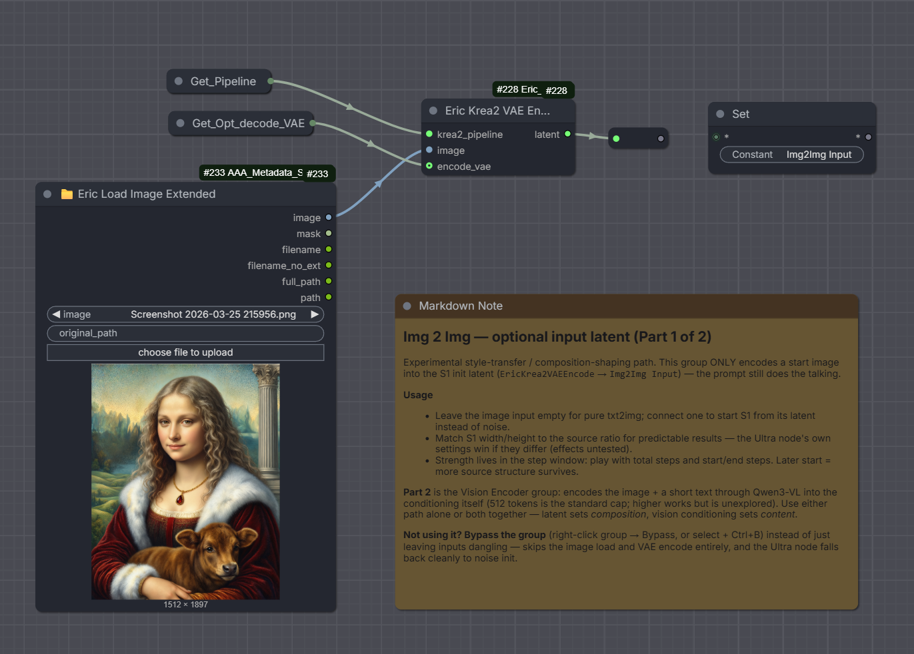
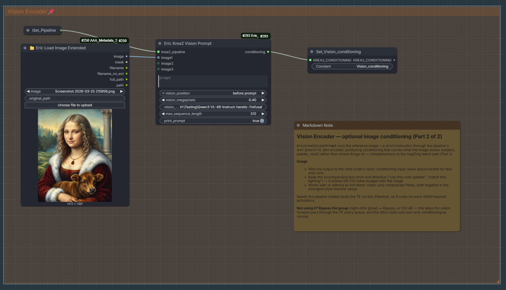

# Image-to-image: img2img, Vision Prompt, reference latents, control, style, paint & edits

[<- Back to the README](../README.md) | [All docs](../README.md#documentation)

## img2img



*img2img (Part 1): a start image is VAE-encoded into the S1 `init_latent`. Denoise strength lives in the step window; the prompt still does the talking. Bypass the group for pure txt2img.*

```
Load Image → Eric Krea2 VAE Encode → (init_latent) Multi-Stage Ultra
                     └→ Eric Krea2 Resolution (image) → width/height → Multi-Stage Ultra
```

Stage 1 re-noises the `init_latent` at `s1_start_step` and denoises the
`[s1_start_step, s1_end_step]` window - so **denoise strength is the step window**,
not a separate float. Feed `width`/`height` from the Resolution node (or turn on
`init_match_size`) to size Stage 1 to the source image.

## Vision Prompt (image-grounded conditioning)



*Vision Prompt (Part 2): a reference image + a short instruction run through Krea2's own Qwen3-VL vision path → `KREA2_CONDITIONING`. Sets content/style; pairs with img2img for structure.*

```
Load Image(s) -> Eric Krea2 Vision Prompt -> (prompt_conditioning) Multi-Stage Ultra
```

Pushes 1-3 reference images through Krea2's own text encoder's vision path (it's a
Qwen3-VL VLM, not text-only), so the resulting conditioning is visually grounded by
those images - a "prompt from a picture" effect - without training anything and
without the pitfalls of the community pattern of reusing the core
`TextEncodeQwenImageEditPlus` node for this: that node's VAE-encoded reference goes
nowhere (the *base* Krea2 DiT has no reference-latent pathway - `Krea2.extra_conds`
never reads reference_latents, so it's silently discarded; an edit-trained LoRA is what
adds one, exposed separately via the
[Reference Latents](#reference-latents-edit-lora-image-conditioning) node), and it falls
back to Qwen3-VL's generic image-description template once an image is attached instead of the
descriptor template Krea2 was actually conditioned with. This node has no VAE step at
all (nothing to discard) and always uses Krea2's own `prompt_template_encode_prefix`/
`_suffix`, read straight off the loaded pipeline so it can't drift out of sync.

**This is semantic grounding, not pixel editing.** With no reference-latent pathway of
its own it gives no structure/identity preservation from the image alone - for that,
pair it with img2img (below): img2img supplies structure (what to start denoising from),
Vision Prompt supplies content (what to draw toward). They're independent channels
into the transformer and compose freely, including with different source images
for each. (If you have an edit-trained LoRA, the
[Reference Latents](#reference-latents-edit-lora-image-conditioning) node adds a third,
pixel-level channel.)

**Positive-conditioning only.** Steering *toward* a reference makes sense; steering
*away* from one is a much stranger ask, and Turbo (the primary target) mostly runs
`cfg=0` anyway - no negative pass to feed. When `prompt_conditioning` is connected,
Ultra's own `prompt` field is entirely inert (not used, not logged) - put your text in
the Vision Prompt node's own `prompt` field instead. `cond_rebalance` still applies to
it, identically to a text-only encode.

**Token budget - the one thing to know before your first run.** Krea2 was trained
with a *fixed* 512-token text budget (prefix + images + prompt, always padded/
truncated to exactly this length) - unlike Qwen-Image's dynamic per-batch padding,
which is why Qwen-Image tolerates a much higher `max_sequence_length` more gracefully.
One full-resolution (1 MP) reference image alone is ~988 tokens - nearly double the
whole budget before your prompt or even the 34-token prefix. To keep this workable
out of the box, the node auto-shares a ~0.40 MP budget across however many images you
connect (1 image ≈ 0.40 MP, 2 ≈ 0.20 MP each, 3 ≈ 0.13 MP each) and raises a clear,
specific error - with a suggested `vision_megapixels` value - rather than silently
truncating into the image-token block (which corrupts position ids and crashes deep
inside `get_rope_index` with a cryptic shape-mismatch instead). `vision_megapixels` is
a ceiling on top of the auto-share, not a replacement for it - lower it to reserve more
room for a long prompt.

## Reference Latents (edit-LoRA image conditioning)

```
Load Image(s) -> Eric Krea2 Reference Latents -> (ref_latents) Multi-Stage Ultra (res)
```

A second, *pixel-level* way to condition on a reference image - complementary to
[Vision Prompt](#vision-prompt-image-grounded-conditioning)'s semantic grounding. Each
reference image is VAE-encoded and flow-packed exactly like a generation latent, then its
tokens are appended to the image sequence and modulated at **t = 0** (clean data) - the
ai-toolkit "index_timestep_zero" edit method. The velocity prediction is sliced back to
the live image tokens, so the references only *inform* the denoise, they aren't denoised
themselves.

**Requires an edit-trained LoRA.** The base Krea2 model was never trained to read these
tokens - this pathway only does something useful with an ai-toolkit `krea2` edit LoRA
(`model_kwargs.edit: true`) loaded, e.g. the Civitai **Krea 2 Style Reference LoRA**.
Without one, the reference tokens are **not** ignored: the base model reads them as image
content and the output breaks up into a blocky mosaic (tested 2026-10-08, with and without
control). Cost is ~2048 extra tokens per 1 MP ref, per denoise step.

**Recommended wiring** (matches the Style Reference LoRA's training setup):
- the reference image(s) → **Reference Latents** (`max_ref_megapixels` 1.0) → `ref_latents`;
- the *same* image(s) → **Vision Prompt** (`vision_megapixels` ≈ 0.15) → `prompt_conditioning`;
- the edit LoRA in the **Multi-LoRA Stack** at strength 1.0;
- **Turbo** checkpoint at **guidance 0**.

**CFG caveat.** The transformer-forward wrapper can't tell a positive pass from a negative
one, so with guidance enabled the references condition *both* passes and partially cancel
in the CFG delta. Keep it on Turbo at `g = 0` (which is what the published edit LoRAs
target anyway). This is an independent diffusers-side reimplementation of the published
mechanism (mechanism credit: ostris / ai-toolkit), not a port.

**Two recipes (`edit_recipe` on the Reference Latents node).** `ostris_t0` (above) is for
style / reference LoRAs. `edit_frame` is the identity / instruction edit method - sources
prepended on the target grid at frame 1..N, shared timestep - placed with the krea2edit v1.2
`fit` geometry (Oct 2026; it previously stretched mismatched aspect ratios) and active on the
stage whose grid it was encoded for. For the Krea 2 Identity Edit LoRA use the dedicated
[Edit node](#edits-krea-2-identity-edit) instead - it adds the grounded instruction encode,
ref_boost and the trained negative.

## Control (ControlNet-LoRA)

```
Load Image -> (depth / pose / canny preprocessor) -> Eric Krea2 Control -> (control) Multi-Stage Ultra
```

Krea 2 "ControlNet" checkpoints are Control-LoRAs: the DiT input projection is expanded
from 64 to 128 channels (`[noisy patches ; control patches]`, trained weights in the
checkpoint) plus a rank-64 LoRA on every block. The control image is VAE-encoded and enters
**clean at every step**. Everything is forward hooks for one generation - nothing is merged
into the weights, so it composes with the LoRA stack and never leaks.

- **Checkpoint** - public: `Patil/Krea-2-depth-controlnet` (trained on Raw, works on Raw
  and Turbo, ~1 MP buckets). Put it in your Krea2 LoRA folder; files with `control` in the
  path are listed first. The checkpoint decides the control *type* - a depth LoRA needs a
  depth map.
- **Depth maps** - `channel_mode` grayscale, `normalize` per_image_minmax, near = **white**
  (`invert` if your preprocessor gives near = dark). Pose / canny / lineart: `rgb`, `none`.
- **Per-stage strength** - scales the block LoRA (the reference's `--lora-scale`); the
  expanded input layer is always full. `0` = that stage runs the stock model. Defaults
  S1 1.0 / S2 0.5 / S3 0 - structure is set in S1, S3 runs far above the trained size.
- The control image is cover-cropped and re-encoded at **each controlled stage's own
  resolution** - keep it at the generation's aspect ratio.

## Style Reference (training-free)

```
Load Image (style) -> Eric Krea2 Style Reference -> (style) Multi-Stage Ultra
```

Transfers a reference's palette, brushwork, texture and rendering language without a LoRA
(port of nkxx188/ComfyUI-Krea2-StyleTransfer). Every styled step runs the model on
`[target, reference]`: the reference is noised to the target's level along a model-guided
trajectory, and in blocks 7-27 the target attends to the reference's keys/values with
frequency-band reweighting - early it may align to the reference layout, late it can no
longer copy positions (no content leakage) but still pulls style statistics.

- **`preset`** - `recommended` locks the original author's low-leakage tuning (custom
  widgets ignored); `custom` exposes them (`ref_k_strength`, `low_scale_end`,
  `high_scale_start/end`, `adain_strength`, `ref_value_mix`, `value_adain_strength`,
  `beta`, `blocks`, `trajectory`, `gamma`).
- **`style_strength`** - overall amount; ~1.0 is strong and coherent at 3 MP; 2.0 can
  overshoot. **`s1/s2/s3_strength`** multiply it per stage; S2/S3 default 0 (S2 refines S1's
  styled result at full speed).
- **`trajectory`** - `model_pc` (original, ~2 x `trajectory_steps` extra evaluations per
  styled stage) or `linear` (free, weaker).
- **Cost** - ~2.3-2.6x per styled step plus the trajectory pass; a 3 MP S1 run on a 48 GB
  card takes ~2 min. On cards under 64 GB with guidance off, the prompt is encoded once and
  the text encoder parks on the CPU for the run so the doubled batch fits.

## Inpaint / outpaint (Paint)

```
Load Image (+ mask) -> Eric Krea2 Paint -> (paint) Multi-Stage Ultra -> [Paint Composite]
                         \-> vlm_image -> Eric Krea2 Vision Prompt (image1, picture_n) -> prompt_conditioning
```

Implements the yijunwang2 **AnyPaint** / **Outpaint** functional adapters on our model:

- a small **condition image** (the canvas with every to-be-generated pixel filled with the
  median known colour, <= 384 px) is registered onto the target grid by fractional RoPE
  coordinates, its keys/values computed once at t = 0 (isolated kv_cache);
- **kept regions are pinned to the source** in velocity space - every sampler (euler, RES,
  DEIS, hybrids, CFG) lands exactly on the source there;
- Stage 1 Euler runs on our fp32 solver when paint is active (bit-level parity with the
  author's pipeline; the stock pipe's bf16 loop drifted).

Settings:

- **`adapter`** - `anypaint` (arbitrary masks, inpaint + outpaint, one pass; put
  `krea2_anypaint_rank32` on the LoRA stack, S1 = 1, S2/S3 = 0), `outpaint` (older,
  rectangular only), `none` (training-free: only pins the kept region - fine for small
  inpaints). Krea 2 **Turbo**, 8 steps, guidance 0.
- **mask** - 1 = generate (ComfyUI mask-editor convention). **`pad_left/right/top/bottom`**
  add outpaint canvas. **`seam_px`** (32) is regenerated around the mask so it blends.
- **`restore_s1/s2/s3`** - `on` pins kept regions every step, `structure` pins while sigma >
  `structure_release_sigma` (0.4) then frees the low-noise detail steps, `auto` = `on` when
  the source has the stage's resolution else `structure`, `off` lets the stage rewrite.
  Defaults on / auto / auto keep identity through S2/S3 without forcing upsampled blur.
- **`adapter_s1/s2/s3`** - adapter conditioning per stage (default S1 only; trained at
  <= 1024 px targets).
- Stage 1 follows the **canvas aspect** at `s1_megapixels` unless width/height are set;
  `crop_bottom` is disabled for paint runs.
- **Paint Composite** pastes the source back with a feathered edge for pixel-exact
  preservation (the Outpaint adapter's post step; AnyPaint does not need it).

## Edits (Krea 2 Identity Edit)

```
Load Image -> Eric Krea2 Edit (instruction) -> (edit) Multi-Stage Ultra
Multi-LoRA Stack: krea2_identity_edit_v1_2  S1 = 1.0, S2 = 0, S3 = 0
```

Instruction editing - recolor, restyle, re-pose, add / replace / remove objects, outpaint,
try-on, person-into-scene - with the **Krea 2 Identity Edit** LoRA
(`conradlocke/krea2-identity-edit`, v1.2; full or the near-identical r128 / r64 files).
Two conditioning paths, exactly as the LoRA was trained:

- **appearance** - the clean VAE-encoded source sits in the sequence as
  `[text | source (frame 1) | source_b (frame 2) | target (frame 0)]`, shared timestep;
- **semantics** - the instruction is encoded by Qwen3-VL **together with the source
  image(s)** ("grounded", natural length - no 512 cap, two 768 px references exceed it).

Settings:

- **`fit_mode`** - `fit` (v1.2 training geometry: AR-preserving resample onto the target
  grid at a fractional centered offset, any output aspect; byte-identical to krea2edit
  v1.2.5) or `crop (legacy)` for v1 / v1.1 weights.
- **`ref_boost`** - reference-fidelity dial: multiplies target -> reference attention
  (1 = off; ~4 strong likeness; >10 breaks removals; <1 loosens). Applies to the last
  reference (the subject in two-reference edits); **`ref_boost_a`** is the scene's dial;
  **`ref_boost_mask`** limits the boost to a region of the last reference (e.g. a face).
  In tests ref_boost 4 kept the source's silhouette closer (a long coat stayed long when
  recoloured).
- **`grounding_px`** - longest side the VLM sees (trained 384-768, default 768): lower =
  stronger instruction adherence, higher = stronger likeness; lower it if subjects duplicate.
- **`size_from`** - `source`: Stage 1 takes the source aspect at `s1_megapixels` (Ultra
  width/height still win); `ultra settings`: Ultra decides and `fit` handles the mismatch
  (wide outpaints).
- **`ground_negative`** - with CFG on, the negative is the empty instruction grounded on
  the same image - the trained unconditional.
- **`source_image_b`** - second reference (the subject) for person-into-scene; place two
  people in ONE pass rather than chaining edits.

Recipe notes (model card + our tests):

- **Turbo, 8-12 steps, guidance off** for most edits; Stage 1 **<= 2 MP** (warned above
  2.2 MP - sources bleed / subjects duplicate). Let S2/S3 upscale.
- **Stages 2/3** run stock (no sources) and refine with **Ultra's `prompt` text** - describe
  the edited image there; empty prompt = they reuse the grounded instruction.
- **Removals** are the weak spot. The card's recipe is **Raw, ~20 steps, CFG 3**
  (`s1_cfg` 2.0 - Krea's g, CFG = 1 + g) with `ground_negative` on; in our test even that
  removed *both* people for "remove the person in the background". Word removals by what to
  keep.
- Prefer ODE samplers (euler, RES, DEIS) for outpainting - SDE churn breaks the reference
  copy channel.
- Cost: the source doubles the image tokens (~3.1 s/step at 1.5 MP on an RTX PRO 5000 vs
  1.3 s for plain text-to-image); ref_boost adds ~6%.
- `crop_bottom` is disabled for edit runs; with `prompt_conditioning` also connected, the
  edit's grounded conditioning wins (printed).
