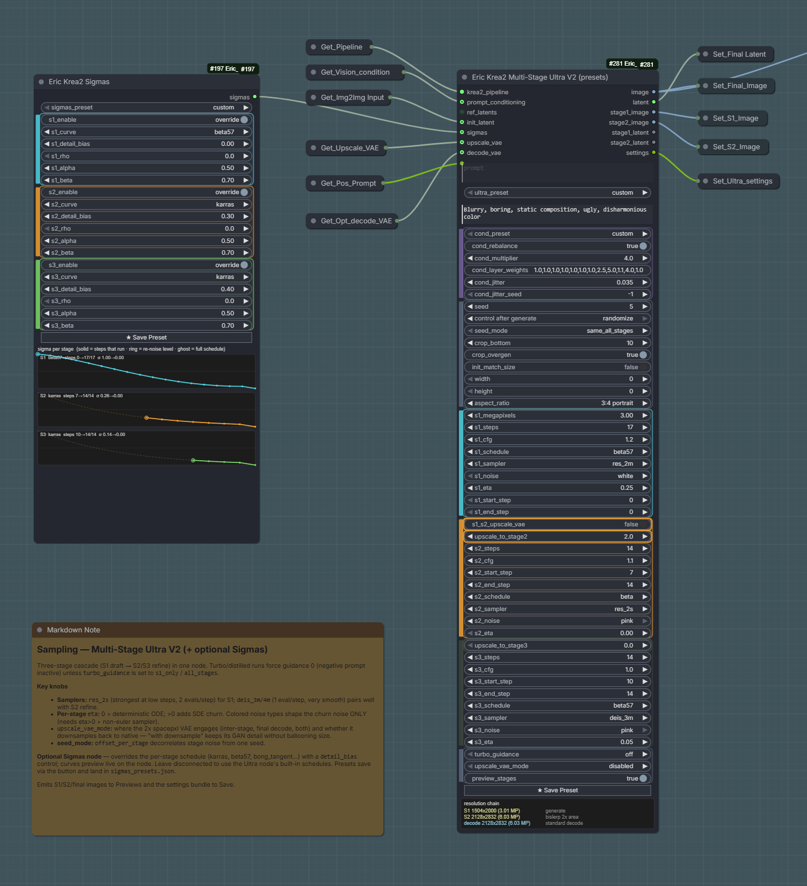

# Samplers, schedules & pairing

[<- Back to the README](../README.md) | [All docs](../README.md#documentation)

## Samplers & schedules

Each stage of the Multi-Stage Ultra node picks a **sampler** (the ODE solver) and a
**schedule** (the sigma spacing) independently.

*A full sampling group - the Sigmas node feeding Multi-Stage Ultra V2, with per-stage samplers/schedules, guidance, re-noise windows, and the on-node resolution-chain readout.*

**Samplers**

| Sampler | Order | Model calls / step | Best for |
|---------|-------|--------------------|----------|
| `euler` | 1 | 1 | Baseline / native parity (the comfy euler+simple twin). Honours early stop and eta (runs as a 1-stage RK). |
| `res_2m` | 2 (multistep) | 1 | General use - sharper than Euler at the same cost. |
| `res_2s` | 2 (single-step) | 2 | Low step counts / Stage-1 draft. Self-starting; ~2× slower. |
| `deis_3m` | 3 (multistep) | 1 | Smooth refine passes. |
| `deis_4m` | 4 (multistep) | 1 | Smoothest refine at higher step counts. |
| `rk6_7s` | ~6 (7-stage RK) | 7 | Maximum solver accuracy (finetuner recipes; the Raw model). ~7x cost per step - overkill for Turbo daily use. |
| `abnorsett_4m` | 4 (exp. multistep) | 1 | Recipe-name alias of `deis_4m` - identical update in this solver formulation. |
| `lcm` | ancestral | 1 | Post-upscale refine windows: jumps to x0 and fully re-noises every step, laundering upscale artifacts. Not for Stage 1. |

Every sampler honours a *noisy early-stop* (`end_step < steps`), letting a stage
hand a partially-denoised latent to the next, and supports the ancestral `eta`
SDE path (`lcm` is inherently fully ancestral - see below). Since the 2026-07-22
shift-consistency fix, `euler` runs through the same solver path as every other
sampler (as a 1-stage Runge-Kutta), so the re-noise level and the stepping always
share one sigma space. The math is recreated from the RES (arXiv:2308.02157) and
DEIS (arXiv:2204.13902) papers plus standard Butcher tableaus - no external
solver code is imported.

**Schedules:** `linear`, `balanced`, `karras`, `beta57`, `beta`, `bong_tangent`,
`linear_quadratic` (ComfyUI-core slow-linear-then-quadratic descent; the kreamania pass-1 schedule),
`exponential`. The **Sigmas** node adds a `detail_bias` knob (biases sigma spacing
toward fine detail vs. large structure) and Beta α/β shaping.

**Recommended pairings** (per the RES4LYF community):
- **Stage 1 (draft):** `res_2s` + `beta57`.
- **Stage 2/3 (refine):** `deis_3m` or `deis_4m` + `bong_tangent`.
- **Post-upscale laundering (native-parity chains):** `lcm` + `linear` with a deep window - see below.

Native parity note: `linear` + `distilled_shift=fixed` reproduces ComfyUI's
`euler`/`simple` spacing exactly (same uniform grid, same exponential mu=1.15
shift) - that pairing IS the native baseline, not an approximation of it.

### Choosing a sampler per stage: warmup & accuracy

Two independent properties decide which solver fits a stage. They often point in
opposite directions, so it's worth understanding both rather than just copying the
pairings above.

**1. Multistep warmup (order build-up).** Multistep solvers (`res_2m`, `deis_3m`,
`deis_4m`) reach their rated order by fitting a polynomial through *past* steps, so
they start low-order and ramp up:

| Step in the run | `deis_3m` effective order |
|-----------------|---------------------------|
| 1st | 1 (Euler-like) |
| 2nd | 2 |
| 3rd onward | 3 (full) |

Crucially, **each stage restarts the solver** - the history buffer is empty at the
stage boundary and does *not* carry across the re-noise handoff. So the ramp is
measured from the first step of *that stage's* run, not the global step index. A
Stage-3 run of `steps=14, start=7, end=14` is **7 sampling steps**, of which the
first ~2 are below full order (full 3rd order from its 3rd step ≈ global step 9).
`deis_4m` ramps over ~3 steps and needs even more runway. Sub-order steps aren't
"wrong" - they're just Euler/2nd-order accurate - but at low step counts the warmup
eats most of the run and the higher order never pays off.

`res_2s` is **self-starting** (a self-contained predictor+corrector, 2 model calls
per step) - full order from step 1, no warmup - which is why it wins when steps are
scarce. Cost balances out because you use fewer of them: `res_2s` @ 4 steps = 8
calls ≈ `deis_3m` @ 7 steps = 7 calls, but cleaner at the low count.

**2. Trajectory smoothness (from-noise vs from-clean).** This is why Stage 1 uses a
single-step solver even though it has plenty of steps to amortize warmup:

- **Stage 1 starts from pure noise** (σ≈max). The early high-σ steps are where the
  model's x₀ prediction is roughest and swings hardest step-to-step, *and* where
  global composition is decided. Multistep solvers extrapolate a polynomial through
  those past predictions, so rough/rapidly-changing history risks **overshoot/ringing
  exactly where structure is set**. `res_2s` doesn't rely on history, so it's robust
  on that rough start, and its corrector buys accuracy on the most consequential
  steps of the whole pipeline.
- **Stages 2/3 start from an already-clean latent** (low-mid σ, smooth trajectory).
  Here the multistep history is reliable, so `deis_3m`'s cheap high-order
  extrapolation genuinely shines.

**Putting it together:**

| Stage | Trajectory | Steps | Pick | Why |
|-------|-----------|-------|------|-----|
| S1 draft | from noise | long | `res_2s` | robustness on the rough start > cheap order |
| S1 draft (cost-saving) | from noise | long | `res_2m` | multistep middle ground: 1 call/step, some early robustness given up |
| S2/S3 refine | from clean | long (≥~8-10) | `deis_3m` | smooth trajectory + cheap order; warmup amortized |
| S2/S3 refine | from clean | very long, smooth schedule | `deis_4m` | marginal extra accuracy once there's runway |
| S3 light refine / no upscale | from clean | few | `res_2s` | self-starting - no warmup waste when steps are scarce |

Rules of thumb: **from noise → self-starting (`res_2s`)**; **from clean + many steps
→ multistep (`deis_3m`/`4m`)**; **from clean + few steps → back to `res_2s`** (no
warmup to waste). `deis_4m` only over `deis_3m` on long, smooth, high-step runs; it's
more prone to overshoot on short or noisy-early-stop stages.

### Trajectory vs churn: where `lcm` fits

Every sampler answers the same question - "given where the latent is and how noisy
it should be, where does it go next?" - and they split into two philosophies.

**The ODE family** (`euler`, `res_2m`, `res_2s`, `deis_*`, `rk6_7s`) treats
denoising as following a *trajectory*. Each step nudges the current latent along
the flow, so information accumulates: real structure, but also upscale ridges,
interpolation error, and leftover mottling get carried forward, refined, and
sharpened into the output. The members differ only in how accurately they follow
the path (euler crudely, rk6_7s obsessively). Faithful is their virtue and their
flaw: they preserve everything, including what you wish they would not.

**`lcm` is the other philosophy.** Each step asks the model for its best guess of
the finished image (the x0 prediction), then throws the current latent away and
rebuilds the next one as that guess plus fresh noise at the next sigma (the
flow-matching mix `(1 - sigma) * x0 + sigma * noise`). No trajectory, no memory:
whatever damage the latent carried - contour lines from a latent upscale, seam
echo, mismatch residue - is discarded every step and replaced by the model's own
clean prior plus new noise. That is why it launders artifacts that deterministic
ODE samplers faithfully integrate. The price is symmetric: it also discards fine
detail the trajectory was carrying, drifts more from the init, and shows larger
seed-to-seed variety.

**The choice rule:** damaged starting latent you want repaired -> `lcm`. Precious
starting latent you want preserved -> an ODE sampler. In between - trajectory with
some laundering - is exactly what `eta > 0` on the res/deis samplers is.

Concretely: post-upscale refine windows are lcm home turf (the latent just got
stretched and is full of interpolation artifacts - the entire secret of the
native euler -> lcm two-pass chains). Stage 1 is ODE territory: you are building
structure from noise and want it followed faithfully, and Turbo is TDM-distilled,
not LCM-distilled, so full-ancestral from pure noise reads rough and unstable.
A same-resolution polish on an already-good image is a judgment call: shallow lcm
freshens texture and kills residue; shallow deis/res preserves likeness.

**What shapes lcm's churn** (it consumes fresh noise every step, so it is the
sampler most sensitive to what that noise is):

- **Window depth** (`start_step`/`end_step`): how much of the image gets rebuilt.
  Deeper start = more repair, more drift.
- **Step count**: number of churn events across the same sigma range - more steps
  = finer-grained laundering.
- **Schedule curve + `detail_bias`** (Sigmas node): where the re-noise ladder
  concentrates. Positive bias packs churn events at low sigma (texture polish);
  negative packs them high (structural repair).
- **`distilled_shift` / mu**: moves the whole ladder (higher mu = more time spent
  churning at high sigma = smoother, deeper repaint).
- **`noise_type` and `eta`**: lcm-family re-noise draws are ALWAYS plain seeded
  white - the model was trained on white noise at every sigma, and a FULL
  replacement with colored noise is out-of-distribution (it decodes as
  chromatic blotches over the image). `noise_type` shaping applies only to the
  fractional SDE churn of the res/deis/rk samplers at `eta > 0`. For
  colored-noise grain character, use `deis_3m`/`res_2m` with eta 0.5-1.0 and a
  `noise_type` - not lcm.
- **Per-stage seed** (`seed_mode`): lcm windows show more seed variety than the
  deterministic solvers - that is the churn, not a defect.

**Recommended lcm refine baseline** (the native-parity chain):

- **S2:** 12 steps, window 6 -> 12 (6 denoise steps), `lcm` + `linear`,
  `distilled_shift=fixed` (the native-parity setting; the pack's default is now `resolution`), eta 0,
  white noise; `upscale_to_stage2` ~1.2 (area),
  S1->S2 VAE upscale OFF (plain latent hop).
- **S3:** 12 steps, window 5 -> 12, otherwise identical; `upscale_to_stage3` ~1.5.
- Artifacts surviving the window -> start deeper (5 or 4). Likeness drifting ->
  start shallower (7-8). Want extra texture -> `detail_bias` +0.2..+0.3.
- Keep lcm off Stage 1 (see above).

### The lcm hybrids & `hybrid_split`

Pure `lcm`'s weakness is that its final detail is bounded by the x0 prediction
at the entry (highest-sigma) steps: the first full re-noise discards the
incoming trajectory - including the previous stage's real detail - and later
steps only polish that re-invention. The hybrids keep lcm's artifact
laundering where it works (the entry steps, where upscale damage lives) and
then develop detail trajectory-faithfully at low sigma, where detail is
actually made:

- **`lcm_hybrid`** - lcm churn, then a `deis_3m` tail.
- **`lcm_hybrid2`** - lcm churn, then a `res_2m` tail (added 2026-07-25;
  res_2m has been testing better than deis_3m as the detail-development half
  on several fine tunes - both tails cost the same per step).
- **`s1/s2/s3_hybrid_steps`** (Ultra widgets, default 0) - the handoff in
  EXACT lcm steps at the head of that stage's window. 0 = auto (half the
  window, ceil - the original behavior). At low step counts this is the
  honest control: a fraction only has window-1 real values, so small %
  changes were silent no-ops. Fewer lcm steps = more trajectory-faithful
  detail; more = more laundering. Clamped so both halves always run; ignored
  by every other sampler. Sweepable via the `hybrid_steps` axis or combos
  JSON (`{"s2_hybrid_steps": 4}`).
- `eta`/`noise_type` apply to the tail half only; the lcm half is inherently
  fully ancestral and always re-noises with plain seeded white (colored
  noise as a full replacement is out-of-distribution -> rainbow blotches).
- `eta` contract: honoured by `res_2m`/`res_2s`/`deis_3m`/`abnorsett_3m`/
  `abnorsett_4m`/`lawson4_4s`/`etdrk4_4s`/`rk6_7s` and the hybrid tails;
  **ignored by `euler` and `lcm`** (euler is the deterministic baseline -
  enforced in the dispatch, and the Sweep Plan automatically drops cells
  that differ only by inert eta/noise on those samplers).

**The Norsett & exponential-RK additions (2026-07-27):** `abnorsett_4m` is
no longer a deis alias - it is the genuine fixed-coefficient Norsett
exponential Adams-Bashforth method (RES4LYF-faithful, verified against its
phi tables), with `abnorsett_3m` as its 3rd-order sibling; the weights
depend only on the current step size, so they stay BOUNDED on every
schedule. `deis_4m` was removed: its exact variable-step weights blow up on
strongly non-uniform ladders (measured 269x on `linear_quadratic`) and
amplify model-prediction noise into garbage - if a saved workflow used it,
pick `abnorsett_4m` (stable order 4, same 1 call/step) or `deis_3m`.
`lawson4_4s` and `etdrk4_4s` are single-step exponential RK order 4
(4 model calls/step, no history): the most noise-robust solvers in the
package, stable everywhere, strong candidates for refine windows. Note
lawson is deliberately not phi-exact for constant forcing (classical
Lawson quadrature) - a texture character difference from etdrk4, not a bug.

### Sampler x schedule pairing guide (12 steps, measured 2026-07-28)

Numbers = median deviation of the final state when the model's per-step
predictions disagree by 2% (the solver's amplification of prediction noise;
lower = more stable). Stability is necessary, not sufficient - which stable
pair looks BEST for a given fine tune is what the sweep decides.

| sampler | best schedules | fine | avoid |
|---|---|---|---|
| `euler`, `res_2s` | any (0.017-0.029) | - | - |
| `lawson4_4s`, `etdrk4_4s` | any (0.009-0.022, noise-suppressing) | - | - |
| `res_2m` | exponential/beta/beta57/karras (0.020-0.022) | linear (0.053) | linear_quadratic (0.152) |
| `deis_3m` | exponential/beta57/beta/karras (0.022-0.025), `OPT-DEIS12` ★ (karras +0.75 bias, 0.023) | bong_tangent/balanced (~0.03), linear (0.118) | linear_quadratic (0.834) |
| `abnorsett_3m` | beta57/beta (0.021), exponential/karras (0.022-0.025) | linear (0.060), linear_quadratic (0.115) | - |
| `abnorsett_4m` | beta57/beta (0.022), `OPT-AB412` ★ (beta57 +0.5 bias) | exponential/karras (~0.03), linear_quadratic (0.178) | - |
| `er_sde` | ANY - 0.048 flat on every schedule incl. linear_quadratic (stochastic contraction; schedule-proof at 1 eval/step). Community recipe: + `simple` @ 8 steps | - | - |
| `lcm_hybrid`/`2` | beta57/beta/karras/exponential (0.023-0.028) + the EXP ★ family | bong_tangent (~0.026) | linear (0.055-0.116), linear_quadratic (~0.15) |

Detail-bias windows (how far you can push `detail_bias` before conditioning
degrades, per curve): deis_3m stays clean on exponential to +0.25, on
beta57/beta from -0.75 to +0.5, and on karras it IMPROVES with positive bias
(clean -0.25 to +0.75 - positive bias straightens the karras tail in
t = -log sigma, which is why `OPT-DEIS12` = karras +0.75 is both the most
detail-holding and among the most stable deis_3m curves). abnorsett_4m:
beta57/beta clean -0.75..+0.5; exponential to 0; karras never fully clean.
Single-step order-4 samplers ignore conditioning entirely - schedule choice
is pure aesthetics there. `OPT-DEIS12` and `OPT-AB412` ship as ★ sigma
presets (S1-only, 12-step recipes).

**Field-tested Stage-1 recipe (2026-07-26, found with the sweep system):**
12 total S1 steps with either hybrid (`lcm_hybrid` / `lcm_hybrid2`) over an
exponential-family custom sigma curve (authored in the Eric Krea2 Sigmas
node and saved as ★ presets - e.g. the EXP1-EXP4 set) lands among the
fastest runs while holding up across most fine tunes and curves. The
handoff sweet spot is **`s1_hybrid_steps = 7` of 12** for most model/curve
combinations. Treat it as a development control: **5-6** lcm steps hands
off earlier and develops more fine detail; **8** (sometimes 9) launders
longer for a cleaner, less-detailed look. The recipe re-derives itself per
fine tune in one sweep: samplers `lcm_hybrid, lcm_hybrid2` x
`hybrid_steps` `5, 6, 7, 8` x your saved curves in `sigma_profiles`.

**Field update (Nov 2026) - current favourite: `lcm_hybrid` + OPT-DEIS12 at 10 steps.** After
many sweeps, `lcm_hybrid` over the OPT-DEIS12 sigma preset is still the best Stage-1 combination,
now at **10 steps instead of 12** (faster as well). OPT-DEIS12 beat OPT-AB412 on the same
checkpoint in both ratings and the trajectory probe (smoother path, lower local error).

**More steps is not always better.** The right step count depends on the sampler: `deis_3m`, which
looked weaker than `lcm_hybrid` at 12 steps, gets better with a few more steps than the hybrid
needs, while the hybrid peaks lower. Past a model's sweet spot, Krea2 Turbo starts inventing **wet,
drippy detail** - sweat beads on people, water on the ground, droplets, sometimes what looks like
spilled jam on skin. It is a fine line between more detail and these artifacts, so sweep `steps`
per sampler rather than assuming more is better.

**Near-free fix: NAG.** Enable NAG on the Negative Guidance node with a negative such as
`sweat, liquid drops, beads of liquid, wet, water droplets, dripping, blood` - with that in place
higher step counts can be used without the wet artifacts. NAG costs ~+23% per step. Its defaults
are fairly strong; see [Tuning NAG](NEGATIVE_GUIDANCE.md#negative-guidance-nag--negpip) for gentler settings.

### SDE band, churn form & the trajectory probe

Added 2026-10-22 (spec: `docs/spec_sde_band_and_trajectory_probe_2026-10-22.md`).

**SDE band.** eta adds fresh noise after each step ("churn"). By default that happens on every
step of the window. `sN_sde_hi` / `sN_sde_lo` restrict it to the steps whose *next* sigma lies
inside the band; the rest of the window runs deterministic. It works with res_2m, res_2s,
deis_3m, abnorsett_3m/4m, lawson4_4s, etdrk4_4s, rk6_7s and the tail of the lcm hybrids (euler,
lcm and er_sde ignore it). Rough Krea2 guide: sigma 1.0-0.5 shapes composition and large
structure, 0.5-0.15 form and detail, below that micro texture. ComfyUI's SA-Solver uses the
band 0.93-0.44 on Krea2 (its 20-80% window at shift 1.15). Every churning stage prints e.g.

    S1 SDE churn (ve, eta 0.5): band sigma[0.93->0.44]: 7/12 steps churned, sigma_next 0.90...0.51

because how many steps land in a band depends on the schedule, steps, shift and window.

**churn_form.** `ve` is the classic k-diffusion ancestral step (and ComfyUI's res_multistep
ancestral). On a flow model it leaves too much image signal in the latent for the sigma the model
is told - measured on a 0.760 -> 0.693 step: +1.4% at eta 0.3, +19.8% at eta 1.0. `rf` is the
rectified-flow form ComfyUI uses for euler_ancestral_RF: it rescales the latent so the signal
matches the sigma exactly. The same eta number means different amounts of noise in the two
forms, so compare them in a sweep (`churn_forms: ve, rf` crossed with `etas`), not at one eta.
Default `rf` since 2026-10-25 (an 8-sampler screen: ve burnt every sampler at eta 0.8, rf held). Images made with eta > 0 before that date used `ve`: set churn_form ve on the Hybrid Sigma Handoff node to reproduce one.

**Trajectory probe.** A measurement, never a change to the image. At each step it reads the
model's predicted clean image and prints per stage:

    [EricKrea2-Probe] S1: lte sum 0.041 peak 0.012 @sigma0.71 | late(<0.3) 18% | drift peak 0.84 @sigma0.84 | clean 9/10 steps

- *drift* - how fast the predicted image is changing per step of log-sigma. Its peak is where the
  model is making its biggest decisions.
- *lte* - a free local-error estimate (difference between a 2nd-order predictor and corrector
  through the same predictions). High where the trajectory bends faster than the steps follow:
  the place to add steps when designing a curve. Proportional to the real error, so compare
  shapes and rankings, not absolute values.
- *late* - share of the error below sigma 0.3 (fine detail).
- *clean* - steps not disturbed by churn noise. Only clean steps count, so read the probe at
  eta 0 or outside the SDE band; lcm steps and er_sde never count.

In sweeps the same numbers land in `sweep_summary.csv` and `sweep_review.xlsx` as `probe_*`
columns next to your ratings, and the full per-step curves go into `sweep_manifest.json`
(`trajectory`). Stage 1 euler text-to-image runs through the stock pipe and is not probed.

**Hybrid handoff by sigma** (2026-10-23, Hybrid Sigma Handoff node). `sN_hybrid_steps` sets the
lcm -> tail switch as a step count, which lands at a different sigma on every schedule and step
count. `sN_hybrid_handoff` sets it as a sigma: the lcm head runs until the ladder reaches it and the
tail takes over from the first step at or below it. The console prints the split, e.g.
`S1 hybrid handoff: 7/12 lcm steps -> tail from sigma 0.69 (handoff sigma 0.70 requested)`.
**Choosing a handoff - detail vs clean.** The handoff is a dial, not a fixed best value. Higher
(earlier switch, longer res_2m tail) = more fine detail and texture, with more risk to composition
and correct drawing; lower (more lcm steps) = cleaner, more correct structure, softer detail. On 12
linear steps: ~0.78 detailed, 0.65 balanced (the node default), 0.45-0.55 clean. Field results
(2026-10-23, Eric's ratings): the darkroom prompt preferred 0.70, the coastal-house prompt 0.60,
some subjects 0.45 - architecture, glass and hands tend to want lower, textured or atmospheric
scenes can take higher. Values only matter where they land on the ladder: on 12 linear steps the
real switch points are sigma 0.76 / 0.69 / 0.61 / 0.51 / 0.39, so 0.5 and 0.4 give the same image.
eta, churn_form and the SDE band changed little on the hybrid (the tail is short and low-sigma);
rf only helps with a long tail (high handoff) at eta > 0.

**Strategy - clean structure first, detail later** (untested idea). Use a low S1 handoff (~0.5) to
get correct composition and drawing, then let S2 put detail back on that settled structure (an S2
refine window starting around sigma 0.5-0.6 with a detail-leaning sampler, or a modest S2 eta).
Detail added during refinement sits on a structure that is already right, so it is less likely to
draw things wrong than detail grown in S1. Test: S1 handoff 0.5 vs 0.78, each with and without the
S2 detail pass - if clean S1 + S2 beats detailed S1, use it for subjects that need both.

Refine windows (S2/S3) start at sigma 0.5-0.76, so keep their handoff inside the window. The node's
churn_form defaults to `rf` - in the first res_2m sweep it never clipped while `ve` burnt at eta 0.7-1.0.

**Sweep axes.** `hybrid_handoffs` takes sigmas (`0.8, 0.7, 0.6, 0.5`). `sde_bands` takes `hi-lo` pairs (`1-0, 0.93-0.44, 1-0.5, 0.5-0.15`) for the
scoped stages; `churn_forms` takes `ve, rf`. Cells where the band can't matter (euler, lcm,
er_sde, or eta 0 in the cell) are removed as duplicates.
